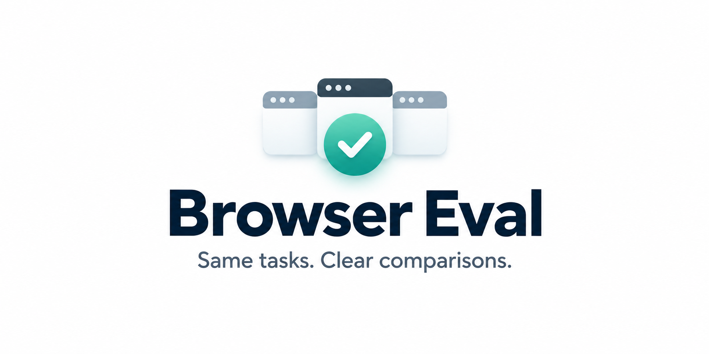
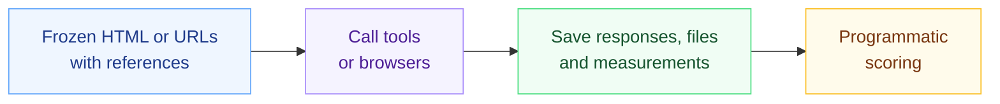
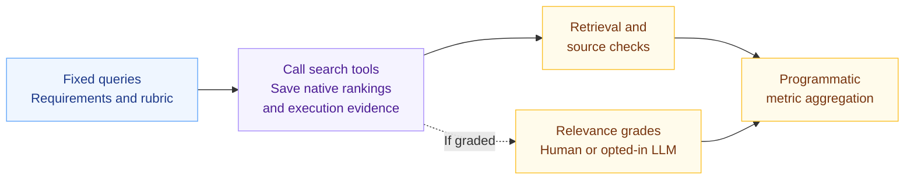
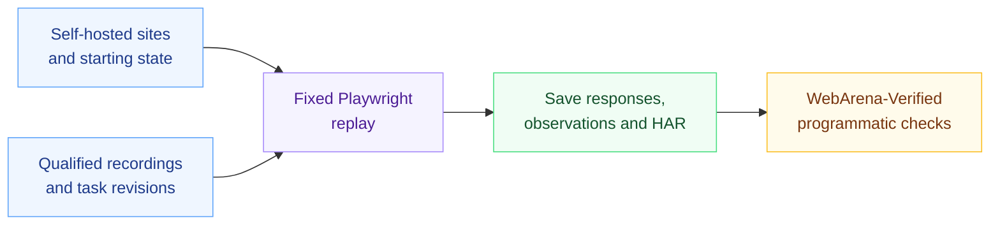
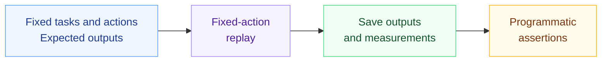
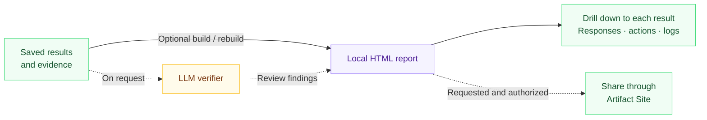

<div align="center">



**English** · [简体中文](docs/README.zh-CN.md)

[](https://github.com/lexmount/browser-eval/actions/workflows/ci.yml)
[](LICENSE)
[](pyproject.toml)

[Features](#features) · [Approach](#evaluation-approach) · [Tracks](#evaluation-tracks) · [Quickstart](#quickstart) · [Reports](#reports) · [Versions](#versions) · [Related projects](#datasets-and-related-projects) · [Contributing](CONTRIBUTING.md)

</div>

Evaluate browsers and Web tools for AI agents through Web Fetch, Web Search and Browser Trajectory Replay. Compare task correctness, latency, resource use and recorded cost. Optionally turn the results into local reports you can inspect, rebuild and share, with drilldown to every individual result and its evidence.

## Features

| Feature | What you get |
| --- | --- |
| Local evaluation | Run a configured comparison and save its evidence. Generate a local HTML report by default, or skip it with `--no-report`. |
| Multiple benchmarks | Use integrated benchmarks or bring your own tasks, with the selected benchmark's scoring rules. [Benchmark integration](docs/benchmarks.md) |
| Extensible participants | Compare browser engines, search APIs, hosted fetch services and extraction tools. Add participants through the existing [adapter contracts](docs/provider-contract.md). |
| Inspectable evidence | Follow aggregate results down to individual responses, action traces and failure logs. |
| Saved-run workflows | Rebuild reports and rescore saved outputs without repeating provider calls. |
| Quality, performance and cost | Compare task success alongside latency, resource usage and recorded billing. |
| Reproducible comparisons | Record task inputs, benchmark and software revisions, scoring code and run settings. |
| Local reports and optional sharing | Inspect and rebuild HTML without an account. Publish to Artifact Site when sharing is requested and authorized. [Reports](#reports) |

## Evaluation approach

Browser Eval aims for stable, reproducible results and a controlled, trustworthy evaluation process. Three principles guide the evaluation.

1. **Prefer definite answers and programmatic scoring wherever possible, with minimal reliance on LLMs as judges**

    When a task has clear answers and acceptance criteria, use code to check the result and reduce variation from model judgment. This does not exclude LLM judges entirely: graded Web Search relevance is a suitable use, with an explicit rubric and retained scoring evidence and grades.

2. **Do not introduce LLMs or Agents to execute the evaluation**

    Web Fetch and Web Search call the tools being tested directly. Browsers are tested through fixed trajectory replay, rather than Browser Use with an Agent choosing the next step. Each participant receives the same work, removing the extra variation from LLM decisions and Agent planning during execution.

3. **Make results easy to review and verify**

    Use an LLM as a verifier to add a check of programmatic verdicts and their supporting evidence. Trigger verification only on request; it does not run by default. Generate local HTML reports with drilldown from aggregate metrics to every individual result, including raw responses, action traces, logs and scoring evidence. Reviewing every result manually is expensive, so reports must also support human sampling. Upload to Artifact Site only when publication is requested and authorized.

The task flows follow below. See [evaluation design](docs/benchmarks.md#evaluation-design) for detailed scoring and verification requirements.

## Evaluation tracks

Choose a workflow for its task contract, setup and runnable example.

| Track | Benchmarks and task suites | Guide |
| --- | --- | --- |
| Web Fetch | [LexBench-Web-Fetch](https://huggingface.co/datasets/Lexmount/LexBench-Web-Fetch), [LexBench-WebMainBench](https://huggingface.co/datasets/Lexmount/LexBench-WebMainBench), [LexBench-WCXB](https://huggingface.co/datasets/Lexmount/LexBench-WCXB) | [Local example](examples/web_fetch/README.md) · [Full guide](src/harness/web_fetch/README.md) |
| Web Search | [LexBench-Web-Search](https://huggingface.co/datasets/Lexmount/LexBench-Web-Search): scenario queries and [LexBench-SimpleQA-Verified](https://huggingface.co/datasets/Lexmount/LexBench-SimpleQA-Verified) retrieval tasks | [Local example](examples/web_search/README.md) · [Full guide](src/harness/web_search/README.md) |
| Browser Trajectory Replay | [Curated fixed-action tasks](https://huggingface.co/datasets/Lexmount/LexBench-Trajectory-Replay) and the separate [WebArena replay datasets](https://huggingface.co/datasets/Lexmount/LexBench-WebArena-Replay), with the pinned WebArena-Verified evaluator | [Curated suite](examples/trajectory_replay/README.md) · [WebArena replay](examples/trajectory_replay/public_webarena/README.md) |

### Web Fetch



### Web Search



Relevance grading is scoring; optional verification reviews the resulting evidence and scores.

### Browser Trajectory Replay

#### WebArena



Task completion is checked in code, without an LLM judge.

#### Repository-curated tasks



### Inspect, rebuild and share



Rebuild from valid saved evidence without new participant calls. Verification adds review findings and does not automatically replace scores.

Experimental [Browser Use](examples/browser_use/README.md) gives an Agent a task, lets it choose browser actions, and checks the recorded outcome with the task evaluator. It includes model and planning variation and is evaluated separately.

## Quickstart

Install [uv](https://docs.astral.sh/uv/getting-started/installation/), then run the offline example:

```sh
git clone https://github.com/lexmount/browser-eval.git
cd browser-eval
uv sync --frozen
uv run --frozen browser-harness-eval validate
uv run --frozen browser-harness-eval run --delay 0
```

Open the report path printed in the terminal. The example has one expected pass and one expected failure; it needs no browser, Docker or API key. Python 3.11–3.14 is supported; development uses 3.11.

Next, [try HTTP, Moli or Chromium on a local article](examples/web_fetch/README.md). Optional adapters, service credentials and live evaluation commands are covered in the track guides above.

The reusable ten-method Web Fetch cohort is selected with `--providers configured --provider-config configs/providers.example.json`; shared defaults are 30 seconds per call and one failure retry. See the [provider contract](docs/provider-contract.md#selected-native-cohort).

## Reports

Results and evidence are saved locally under `~/.browser-eval/runs/`; use `--output /absolute/path/new-run` to choose another directory. HTML reports include comparisons, task results, full responses and failure evidence. Local evaluation, scoring and HTML inspection need no Artifact Site account or publishing authorization.

The `run` command builds a local report by default. Add `--no-report` to save results without HTML; `rescore --no-report` updates scores without rebuilding HTML. Build or rebuild a report later from saved evidence without repeating calls:

```sh
uv run --frozen browser-harness-eval run --delay 0 --no-report
uv run --frozen browser-harness-eval report /absolute/path/to/run
```

English is the default; add `--language zh` when running or rebuilding for Chinese. A rebuild without that option keeps the saved language.

### Optional sharing

When sharing is requested and publication is authorized, open Artifact Site ([Global .com](https://yours.lexmount.com/artifact-site) · [China .cn](https://yours.lexmount.cn/artifact-site)), install the skill offered there, and follow it to publish the local report and choose who can access it. Uploading is a separate action; creating a local report does not publish it.

Scoring code ships with Browser Eval; dataset commits and file hashes are selected in [the data lock](src/harness/benchmarks/data-lock.json). Each report records its Browser Eval build and selected benchmark edition. See [versioning](docs/benchmarks.md#benchmark-editions) for comparison rules, [reference inputs](docs/reference-inputs.md) for historical data, and the [report guide](docs/report-hosting.md) for local builds and formal releases.

## Versions

Published versions, changes and dependency snapshots are listed in [GitHub Releases](https://github.com/lexmount/browser-eval/releases). See [version rules](docs/releases.md) for release policy and report provenance.

## Datasets and related projects

| Resource | Role |
| --- | --- |
| [LexBench-Web-Fetch](https://huggingface.co/datasets/Lexmount/LexBench-Web-Fetch) | Versioned Web Fetch tasks, acceptance contracts and reference bindings |
| [LexBench-Web-Search](https://huggingface.co/datasets/Lexmount/LexBench-Web-Search) | Scenario search queries and source references; factual QA is provided by SimpleQA Verified |
| [LexBench-WebMainBench](https://huggingface.co/datasets/Lexmount/LexBench-WebMainBench) | Reference-corrected WebMainBench tasks and correction provenance |
| [LexBench-SimpleQA-Verified](https://huggingface.co/datasets/Lexmount/LexBench-SimpleQA-Verified) | Length-qualified SimpleQA Verified retrieval tasks, with original answers |
| [LexBench-WCXB](https://huggingface.co/datasets/Lexmount/LexBench-WCXB) | Source-qualified frozen extraction inputs and references |
| [LexBench-Headless-Browser](https://huggingface.co/datasets/Lexmount/LexBench-Headless-Browser) · [code](https://github.com/lexmount/Lexbench-Headless-Browser) | Executable CDP, driver and web-platform tasks; scenario specifications retained as source inputs |
| [LexBench-Trajectory-Replay](https://huggingface.co/datasets/Lexmount/LexBench-Trajectory-Replay) | 30 tasks written in Browser Eval for live public websites, with fixed actions and exact checks |
| [LexBench-WebArena-Replay](https://huggingface.co/datasets/Lexmount/LexBench-WebArena-Replay) | Full official task catalog; smaller replay editions retained as versioned source inputs |
| [Moli](https://github.com/lexmount/moli) | Browser evaluated through the same task contracts as other participants |
| [WebFetch CLI](https://github.com/lexmount/webfetch-cli) | CLI client for the Lexmount WebFetch service; separate from the evaluation harness |
| Artifact Site ([Global .com](https://yours.lexmount.com/artifact-site) · [China .cn](https://yours.lexmount.cn/artifact-site)) | Report creation and sharing with access controls |
| [WebMainBench fork](https://github.com/lexmount/WebMainBench/tree/lex-main) · [upstream](https://github.com/opendatalab/WebMainBench) | Upstream attribution and source of the pinned extraction scorer |
| [WebArena-Verified fork](https://github.com/lexmount/webarena-verified/tree/lex-main) · [upstream](https://github.com/ServiceNow/webarena-verified) | Official task attribution and pinned evaluator dependency for replay and experimental Agent integration |
| [WCXB upstream](https://github.com/Murrough-Foley/web-content-extraction-benchmark) | Source attribution for the qualified HF edition |
| [CowAgent](https://github.com/zhayujie/CowAgent), [OpenClaw](https://github.com/openclaw/openclaw), [DeepSeek Harness](https://github.com/deepseek-ai/deepseek-harness) | Web Fetch tool baselines and experimental Agent integration |

Browser Eval wrote the 30 public-web replay tasks. Headless scenario designs informed some interactions; its executable cases and WebArena's tasks are not included in that suite. The task JSON fixes actions and expected outputs, while the target websites remain live.

[Dependency sources and pins](docs/dependencies.md) cover Playwright, extraction libraries and supporting runtimes. [Third-party notices](THIRD_PARTY.md) cover attribution and data rights. Cite the benchmark and upstream data used alongside Browser Eval.

## Contribute

Read [CONTRIBUTING](CONTRIBUTING.md) for code ownership, tests and PR conventions, or [open an issue](https://github.com/lexmount/browser-eval/issues) with a reproducible example.

```sh
make setup-test
make ci
```

[Architecture](docs/architecture.md) · [Security](SECURITY.md) · [Third-party content](THIRD_PARTY.md) · [Apache 2.0](LICENSE)

## Cite Browser Eval

Project citation: [CITATION.cff](CITATION.cff).

```bibtex
@software{browser_eval_2026,
  author = {{Browser Eval contributors}},
  title = {Browser Eval: Benchmarking Browsers and Web Tools for AI Agents},
  note = {Evaluation harness},
  year = {2026},
  url = {https://github.com/lexmount/browser-eval}
}
```
