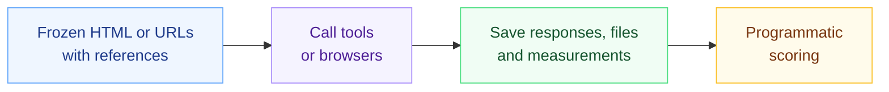
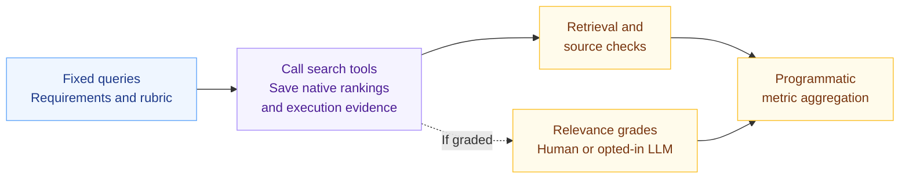
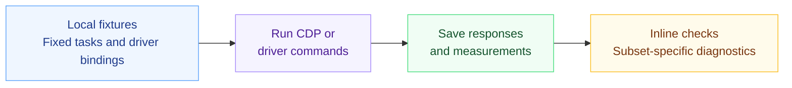
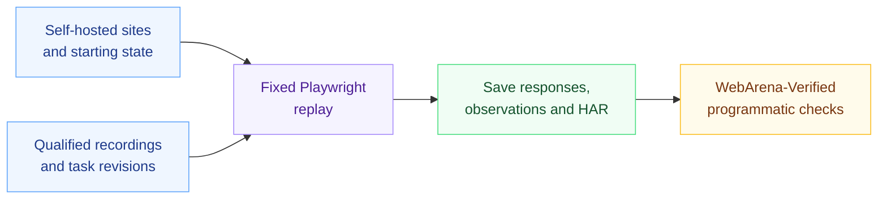
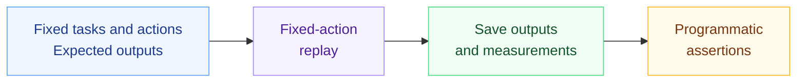
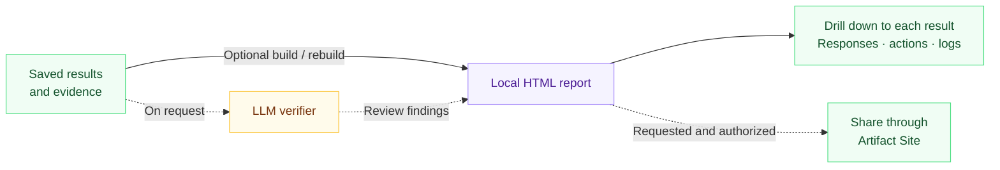

<div align="center">


**English** · [简体中文](docs/README.zh-CN.md)

[](https://github.com/lexmount/browser-eval/actions/workflows/ci.yml)
[](LICENSE)
[](pyproject.toml)

[Quickstart](#quickstart) · [Tracks](#evaluation-tracks) · [Approach](#evaluation-approach) · [Reports](#reports) · [Datasets and code](#datasets-and-code) · [Versions](#versions) · [Contributing](CONTRIBUTING.md)

</div>

Benchmark browsers and Web tools for AI agents through fetching, search, browser compatibility tests and fixed trajectory replay. Compare correctness, latency, resource use and recorded cost. Optionally turn saved results into local reports you can inspect, rebuild and share, with drilldown to every individual result.

## Quickstart

Install [uv](https://docs.astral.sh/uv/getting-started/installation/), then run the offline example:

```sh
git clone https://github.com/lexmount/browser-eval.git
cd browser-eval
uv sync --frozen
uv run --frozen browser-harness-eval validate
uv run --frozen browser-harness-eval run --delay 0
```

Open the report path printed in the terminal. The example has one expected pass and one expected failure; it needs no browser, Docker or API key. Python 3.11–3.14 is supported; development uses 3.11.

Next, [try HTTP, Moli or Chromium on a local article](examples/web_fetch/README.md). Optional adapters, service credentials and live evaluation commands are covered in the track guides.

The reusable ten-method Web Fetch cohort is selected with `--providers configured --provider-config configs/providers.example.json`; shared defaults are 30 seconds per call and one failure retry. See the [provider contract](docs/provider-contract.md#selected-native-cohort).

## Evaluation tracks

Choose a workflow for its task contract, setup and runnable example.

| Track | Benchmarks and task suites | Guide |
| --- | --- | --- |
| Web Fetch | [LexBench-Web-Fetch](https://huggingface.co/datasets/Lexmount/LexBench-Web-Fetch), [LexBench-WebMainBench](https://huggingface.co/datasets/Lexmount/LexBench-WebMainBench), [LexBench-WCXB](https://huggingface.co/datasets/Lexmount/LexBench-WCXB) | [Local example](examples/web_fetch/README.md) · [Full guide](src/harness/web_fetch/README.md) |
| Web Search | [LexBench-Web-Search](https://huggingface.co/datasets/Lexmount/LexBench-Web-Search): scenario queries and [LexBench-SimpleQA-Verified](https://huggingface.co/datasets/Lexmount/LexBench-SimpleQA-Verified) retrieval tasks | [Local example](examples/web_search/README.md) · [Full guide](src/harness/web_search/README.md) |
| Browser compatibility | [LexBench-Headless-Browser](https://huggingface.co/datasets/Lexmount/LexBench-Headless-Browser): CDP, driver and Web-platform behavior on local fixtures | [Pinned inputs and original runner](https://huggingface.co/datasets/Lexmount/LexBench-Headless-Browser#execute-with-the-original-runner) |
| Browser Trajectory Replay | [Curated fixed-action tasks](https://huggingface.co/datasets/Lexmount/LexBench-Trajectory-Replay) with explicit checks; [WebArena replay](https://huggingface.co/datasets/Lexmount/LexBench-WebArena-Replay) with the official evaluator | [Curated suite](examples/trajectory_replay/README.md) · [WebArena replay](examples/trajectory_replay/public_webarena/README.md) |

Use these suites or [bring your own tasks](docs/benchmarks.md). Add browsers and tools through the existing [adapter contracts](docs/provider-contract.md).

Experimental [Browser Use](examples/browser_use/README.md) gives an Agent a task, lets it choose browser actions, and checks the recorded outcome with the task evaluator. It includes model and planning variation and is evaluated separately.

<details>
<summary>How each evaluation workflow runs</summary>

### Web Fetch



### Web Search



Relevance grading is scoring; optional verification reviews the resulting evidence and scores.

### Browser compatibility

LexBench-Headless-Browser runs predefined compatibility checks on local fixtures, covering CDP, drivers and Web platform behavior. Its original runner owns execution and grading; trajectory replay uses separate fixed-action tasks to complete website goals.



### Browser Trajectory Replay

#### WebArena



Task completion is checked in code, without an LLM judge.

#### Repository-curated tasks



</details>

## Evaluation approach

Browser Eval aims for stable, reproducible results and a controlled, trustworthy evaluation process. Three principles guide the evaluation.

1. **Prefer definite answers and programmatic scoring wherever possible, with minimal reliance on LLMs as judges**

    When a task has clear answers and acceptance criteria, use code to check the result and reduce variation from model judgment. This does not exclude LLM judges entirely: graded Web Search relevance is a suitable use, with an explicit rubric and retained scoring evidence and grades.

2. **Do not introduce LLMs or Agents to execute the evaluation**

    Web Fetch and Web Search call tools directly; compatibility tests run fixed probes; trajectory replay follows fixed actions. Participants follow the same task contracts, avoiding extra variation from LLM decisions and Agent planning. Each run retains its task inputs, code revisions and execution settings.

3. **Make results easy to review and verify**

    Use an LLM as a verifier to add a check of programmatic verdicts and their supporting evidence. Trigger verification only on request; it does not run by default. Generate local HTML reports with drilldown from aggregate metrics to every individual result, including raw responses, action traces, logs and scoring evidence. Reviewing every result manually is expensive, so reports must also support human sampling. Upload to Artifact Site only when publication is requested and authorized.

See [evaluation design](docs/benchmarks.md#evaluation-design) for detailed scoring and verification requirements.

## Reports

Results and evidence are saved locally under `~/.browser-eval/runs/`; use `--output /absolute/path/new-run` to choose another directory. HTML reports include comparisons, task results, full responses and failure evidence. Local evaluation, scoring and HTML inspection need no Artifact Site account or publishing authorization.

The `run` command builds a local report by default. Add `--no-report` to save results without HTML; `rescore --no-report` updates scores without rebuilding HTML. Build or rebuild a report later from saved evidence without repeating calls:

```sh
uv run --frozen browser-harness-eval run --delay 0 --no-report
uv run --frozen browser-harness-eval report /absolute/path/to/run
```

English is the default; add `--language zh` when running or rebuilding for Chinese. A rebuild without that option keeps the saved language.

### Optional sharing

When sharing is requested and publication is authorized, open Artifact Site ([Global .com](https://yours.lexmount.com/artifact-site) · [China .cn](https://yours.lexmount.cn/artifact-site)), install the skill offered there, and follow it to publish the local report and choose who can access it. Uploading is a separate action; creating a local report does not publish it.

Scoring code ships with Browser Eval; dataset commits and file hashes are selected in [the data lock](src/harness/benchmarks/data-lock.json). Each report records its Browser Eval build and selected benchmark edition. See [versioning](docs/benchmarks.md#benchmark-editions) for comparison rules, [reference inputs](docs/reference-inputs.md) for historical data, and the [report guide](docs/report-hosting.md) for local builds and formal releases.

<details>
<summary>Report drilldown, rebuilding and sharing</summary>



Rebuild from valid saved evidence without new participant calls. Verification adds review findings and does not automatically replace scores.

</details>

## Datasets and code

<details>
<summary>Hugging Face datasets</summary>

These links provide versioned tasks, acceptance contracts and reference inputs.

| Dataset | Role |
| --- | --- |
| [LexBench-Web-Fetch](https://huggingface.co/datasets/Lexmount/LexBench-Web-Fetch) | Versioned Web Fetch tasks, acceptance contracts and reference bindings |
| [LexBench-Web-Search](https://huggingface.co/datasets/Lexmount/LexBench-Web-Search) | Scenario search queries and source references; factual QA is provided by SimpleQA Verified |
| [LexBench-WebMainBench](https://huggingface.co/datasets/Lexmount/LexBench-WebMainBench) | Reference-corrected WebMainBench tasks and correction provenance |
| [LexBench-SimpleQA-Verified](https://huggingface.co/datasets/Lexmount/LexBench-SimpleQA-Verified) | Length-qualified SimpleQA Verified retrieval tasks, with original answers |
| [LexBench-WCXB](https://huggingface.co/datasets/Lexmount/LexBench-WCXB) | Source-qualified frozen extraction inputs and references |
| [LexBench-Headless-Browser](https://huggingface.co/datasets/Lexmount/LexBench-Headless-Browser) | Executable CDP, driver and web-platform tasks; scenario specifications retained as source inputs |
| [LexBench-Trajectory-Replay](https://huggingface.co/datasets/Lexmount/LexBench-Trajectory-Replay) | 30 tasks written in Browser Eval for live public websites, with fixed actions and exact checks |
| [LexBench-WebArena-Replay](https://huggingface.co/datasets/Lexmount/LexBench-WebArena-Replay) | Full official task catalog; smaller replay editions retained as versioned source inputs |

Browser Eval wrote the 30 public-web replay tasks. Headless scenario designs informed some interactions; its executable cases and WebArena's tasks are not included in that suite. The task JSON fixes actions and expected outputs, while the target websites remain live.

</details>

<details>
<summary>Evaluation code and upstream sources</summary>

Web Fetch and Web Search scoring code lives in this repository under [src/lexbench_webfetch/](src/lexbench_webfetch/) and [src/lexbench_websearch/](src/lexbench_websearch/). Install and run it through the quickstart above.

| Component | Purpose | Code or source |
| --- | --- | --- |
| Headless Browser | Original CDP, driver and local-fixture runner | [Original repository](https://github.com/lexmount/Lexbench-Headless-Browser) |
| WebMainBench | Pinned extraction scorer and upstream attribution | [Maintained fork](https://github.com/lexmount/WebMainBench/tree/lex-main) · [Upstream](https://github.com/opendatalab/WebMainBench) |
| WebArena-Verified | Official evaluator for replay and experimental Agent integration | [Maintained fork](https://github.com/lexmount/webarena-verified/tree/lex-main) · [Upstream](https://github.com/ServiceNow/webarena-verified) |
| WCXB | Original data source for the qualified HF edition | [Upstream](https://github.com/Murrough-Foley/web-content-extraction-benchmark) |

[Dependency sources and pins](docs/dependencies.md) cover Playwright, extraction libraries and supporting runtimes. [Third-party notices](THIRD_PARTY.md) cover attribution and data rights. Cite the benchmark and upstream data used alongside Browser Eval.

</details>

<details>
<summary>Browsers and tools</summary>

| Project | Type | Use |
| --- | --- | --- |
| [Moli](https://github.com/lexmount/moli) | Browser | Evaluated through the same task contracts as other participants |
| [WebFetch CLI](https://github.com/lexmount/webfetch-cli) | CLI client | Calls the Lexmount WebFetch service |
| [CowAgent](https://github.com/zhayujie/CowAgent) | Agent framework | Web Fetch tool baseline and experimental Agent integration |
| [OpenClaw](https://github.com/openclaw/openclaw) | Agent framework | Web Fetch tool baseline and experimental Agent integration |
| [DeepSeek Harness](https://github.com/deepseek-ai/deepseek-harness) | Agent framework | Web Fetch tool baseline and experimental Agent integration |

</details>

## Versions

Published versions, changes and dependency snapshots are listed in [GitHub Releases](https://github.com/lexmount/browser-eval/releases). See [version rules](docs/releases.md) for release policy and report provenance.

## Contribute

Read [CONTRIBUTING](CONTRIBUTING.md) for code ownership, tests and PR conventions, or [open an issue](https://github.com/lexmount/browser-eval/issues) with a reproducible example.

```sh
make setup-test
make ci
```

[Architecture](docs/architecture.md) · [Security](SECURITY.md) · [Third-party content](THIRD_PARTY.md) · [Apache 2.0](LICENSE)

## Cite Browser Eval

Project citation: [CITATION.cff](CITATION.cff).

```bibtex
@software{browser_eval_2026,
  author = {{Browser Eval contributors}},
  title = {Browser Eval: Benchmarking Browsers and Web Tools for AI Agents},
  note = {Evaluation harness},
  year = {2026},
  url = {https://github.com/lexmount/browser-eval}
}
```
