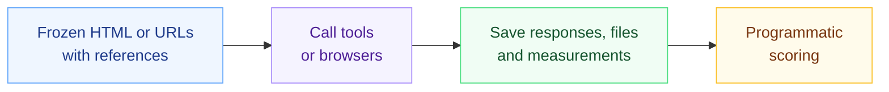
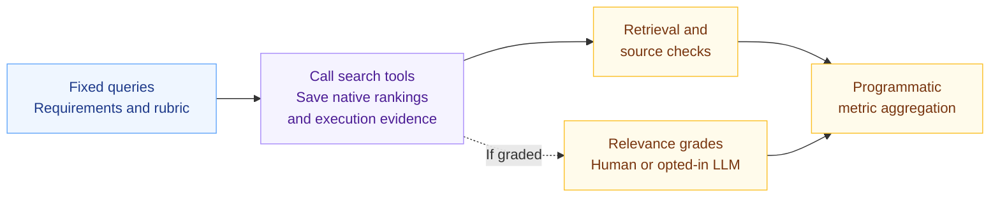
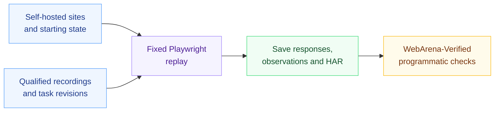
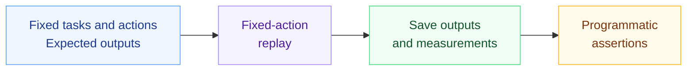
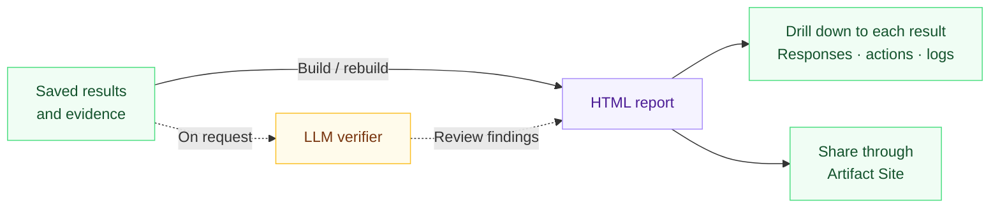

<div align="center">


<h3>Browser Eval: Benchmarking Browsers and Web Tools for AI Agents</h3>

**English** · [简体中文](docs/README.zh-CN.md)

[](https://github.com/lexmount/browser-eval/actions/workflows/ci.yml)
[](LICENSE)
[](pyproject.toml)

[Features](#features) · [Approach](#evaluation-approach) · [Tracks](#evaluation-tracks) · [Quickstart](#quickstart) · [Reports](#reports) · [Versions](#versions) · [Related projects](#related-repositories) · [Contributing](CONTRIBUTING.md)

</div>

Evaluate browsers and Web tools for AI agents through Web Fetch, Web Search and Browser Trajectory Replay. Compare task correctness, latency, resource use and recorded cost. Turn the results into reports you can inspect, rebuild and share, with drilldown to every individual result and its evidence.

## Features

| Feature | What you get |
| --- | --- |
| Run to report | Run a configured comparison and generate an HTML report with one CLI command. |
| Multiple benchmarks | Use integrated benchmarks or bring your own tasks, with the selected benchmark's scoring rules. [Benchmark integration](docs/benchmarks.md) |
| Extensible participants | Compare browser engines, search APIs, hosted fetch services and extraction tools. Add participants through the existing [adapter contracts](docs/provider-contract.md). |
| Inspectable evidence | Follow aggregate results down to individual responses, action traces and failure logs. |
| Saved-run workflows | Rebuild reports and rescore saved outputs without repeating provider calls. |
| Quality, performance and cost | Compare task success alongside latency, resource usage and recorded billing. |
| Reproducible comparisons | Record task inputs, benchmark and software revisions, scoring code and run settings. |
| Reports you can share | Publish through Artifact Site and choose who can access the report. [Create and share a report](#reports) |

## Evaluation approach

Browser Eval aims for stable, reproducible results and a controlled, trustworthy evaluation process. Three principles guide the evaluation.

1. **Prefer definite answers and programmatic scoring wherever possible, with minimal reliance on LLMs as judges**

    When a task has clear answers and acceptance criteria, use code to check the result and reduce variation from model judgment. This does not exclude LLM judges entirely: graded Web Search relevance is a suitable use, with an explicit rubric and retained scoring evidence and grades.

2. **Do not introduce LLMs or Agents to execute the evaluation**

    Web Fetch and Web Search call the tools being tested directly. Browsers are tested through fixed trajectory replay, rather than Browser Use with an Agent choosing the next step. Each participant receives the same work, removing the extra variation from LLM decisions and Agent planning during execution.

3. **Make results easy to review and verify**

    Use an LLM as a verifier to add a check of programmatic verdicts and their supporting evidence. Trigger verification only on request; it does not run by default. Generate HTML reports and upload them to Artifact Site, with drilldown from aggregate metrics to every individual result, including raw responses, action traces, logs and scoring evidence. Reviewing every result manually is expensive, so reports must also support human sampling.

The task flows follow below. See [evaluation design](docs/benchmarks.md#evaluation-design) for detailed scoring and verification requirements.

## Evaluation tracks

Choose a workflow for its task contract, setup and runnable example.

| Track | Benchmarks and task suites | Guide |
| --- | --- | --- |
| Web Fetch | [LexBench Web Fetch](https://github.com/lexmount/lexbench-webfetch), [WebMainBench](https://github.com/opendatalab/WebMainBench), [WCXB](https://github.com/Murrough-Foley/web-content-extraction-benchmark) | [Local example](examples/web_fetch/README.md) · [Full guide](harness/web_fetch/README.md) |
| Web Search | [LexBench Web Search](https://github.com/lexmount/lexbench-websearch): scenario queries and a SimpleQA Verified retrieval adaptation | [Local example](examples/web_search/README.md) · [Full guide](harness/web_search/README.md) |
| Browser Trajectory Replay | [Repository-curated fixed-action suite](examples/trajectory_replay/README.md), adapted from [Lexbench-Headless-Browser scenario designs](https://github.com/lexmount/Lexbench-Headless-Browser/tree/3f1580a20922fc3f339b5fc279d9bbdb06d5d194/tasks/scenarios); [qualified WebArena human recordings](evaluation/browser-use-public/webarena-human-suite.json), checked with the [WebArena-Verified evaluator](https://github.com/lexmount/webarena-verified/tree/lex-main) | [Curated suite](examples/trajectory_replay/README.md) · [WebArena replay](examples/trajectory_replay/public_webarena/README.md) |

### Web Fetch



### Web Search



Relevance grading is scoring; optional verification reviews the resulting evidence and scores.

### Browser Trajectory Replay

#### WebArena



Task completion is checked in code, without an LLM judge.

#### Repository-curated tasks



### Inspect, rebuild and share



Rebuild from valid saved evidence without new participant calls. Verification adds review findings and does not automatically replace scores.

Experimental [Browser Use](examples/browser_use/README.md) gives an Agent a task, lets it choose browser actions, and checks the recorded outcome with the task evaluator. It includes model and planning variation and is evaluated separately.

## Quickstart

Install [uv](https://docs.astral.sh/uv/getting-started/installation/), then run the offline example:

```sh
git clone https://github.com/lexmount/browser-eval.git
cd browser-eval
uv sync --frozen
uv run --frozen browser-harness-eval validate
uv run --frozen browser-harness-eval run --delay 0
```

Open the report path printed in the terminal. The example has one expected pass and one expected failure; it needs no browser, Docker or API key. Python 3.11–3.14 is supported; development uses 3.11.

Next, [try HTTP, Moli or Chromium on a local article](examples/web_fetch/README.md). Optional adapters, service credentials and live evaluation commands are covered in the track guides above.

The reusable ten-method Web Fetch cohort is selected with `--providers configured --provider-config configs/providers.example.json`; shared defaults are 30 seconds per call and one failure retry. See the [provider contract](docs/provider-contract.md#selected-native-cohort).

## Reports

To create and share a report, open Artifact Site ([Global .com](https://yours.lexmount.com/artifact-site) · [China .cn](https://yours.lexmount.cn/artifact-site)) and install the skill offered there. Follow the skill to create and publish your report, then choose who can access it.

Reports include comparisons, task results, full responses and failure evidence. Runs are saved under `~/.browser-eval/runs/`; use `--output /absolute/path/new-run` to choose another directory.

Rebuild from saved evidence without repeating calls:

```sh
uv run --frozen browser-harness-eval report /absolute/path/to/run
```

English is the default; add `--language zh` when running or rebuilding for Chinese. A rebuild without that option keeps the saved language.

Each new report records its Browser Eval build and selected benchmark edition, with exact code and input hashes. See [versioning](docs/benchmarks.md#benchmark-editions) for comparison rules and [reference inputs](docs/reference-inputs.md) for historical data.

See the [report guide](docs/report-hosting.md) for local builds and formal benchmark releases.

## Versions

Published versions, changes and dependency snapshots are listed in [GitHub Releases](https://github.com/lexmount/browser-eval/releases). See [version rules](docs/releases.md) for release policy and report provenance.

## Related repositories

| Repository | Role |
| --- | --- |
| [LexBench Web Fetch](https://github.com/lexmount/lexbench-webfetch) | Versioned Web Fetch tasks, acceptance scoring and frozen input bindings |
| [LexBench Web Search](https://github.com/lexmount/lexbench-websearch) | Versioned search queries, source references and retrieval scoring |
| [Moli](https://github.com/lexmount/moli) | Browser evaluated through the same task contracts as other participants |
| [WebFetch CLI](https://github.com/lexmount/webfetch-cli) | CLI client for the Lexmount WebFetch service; separate from the evaluation harness |
| Artifact Site ([Global .com](https://yours.lexmount.com/artifact-site) · [China .cn](https://yours.lexmount.cn/artifact-site)) | Report creation and sharing with access controls |
| [Lexbench-Headless-Browser](https://github.com/lexmount/Lexbench-Headless-Browser) | Scenario design source for curated replay; separate protocol, driver and web-platform benchmarks |
| [WebMainBench fork](https://github.com/lexmount/WebMainBench/tree/lex-main) · [upstream](https://github.com/opendatalab/WebMainBench) | Frozen-HTML extraction tasks and declared scoring corrections |
| [WebArena-Verified fork](https://github.com/lexmount/webarena-verified/tree/lex-main) · [upstream](https://github.com/ServiceNow/webarena-verified) | Tasks and evaluator for WebArena trajectory replay and experimental Agent integration |
| [WCXB](https://github.com/Murrough-Foley/web-content-extraction-benchmark) | Independent content-extraction benchmark |
| [CowAgent](https://github.com/zhayujie/CowAgent), [OpenClaw](https://github.com/openclaw/openclaw), [DeepSeek Harness](https://github.com/deepseek-ai/deepseek-harness) | Web Fetch tool baselines and experimental Agent integration |

[Dependency sources and pins](docs/dependencies.md) cover Playwright, extraction libraries and supporting runtimes. [Third-party notices](THIRD_PARTY.md) cover attribution and data rights. Cite the benchmark and upstream data used alongside Browser Eval.

## Contribute

Read [CONTRIBUTING](CONTRIBUTING.md) for code ownership, tests and PR conventions, or [open an issue](https://github.com/lexmount/browser-eval/issues) with a reproducible example.

```sh
make setup-test
make ci
```

[Architecture](docs/architecture.md) · [Security](SECURITY.md) · [Third-party content](THIRD_PARTY.md) · [Apache 2.0](LICENSE)

## Cite Browser Eval

Project citation: [CITATION.cff](CITATION.cff).

```bibtex
@software{browser_eval_2026,
  author = {{Browser Eval contributors}},
  title = {Browser Eval: Benchmarking Browsers and Web Tools for AI Agents},
  note = {Evaluation harness},
  year = {2026},
  url = {https://github.com/lexmount/browser-eval}
}
```
