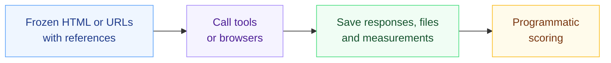
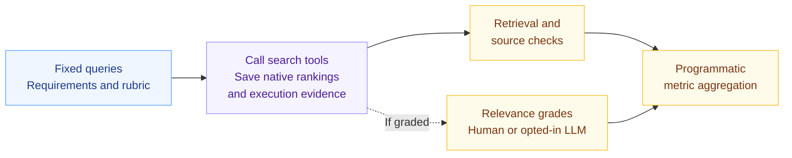
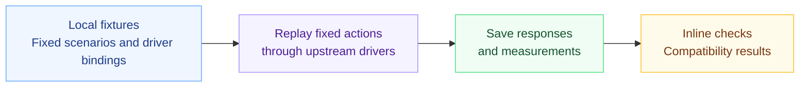
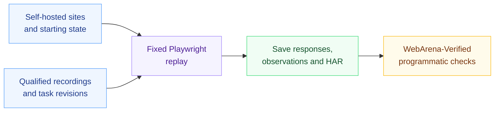
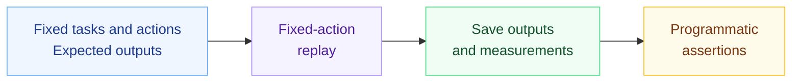
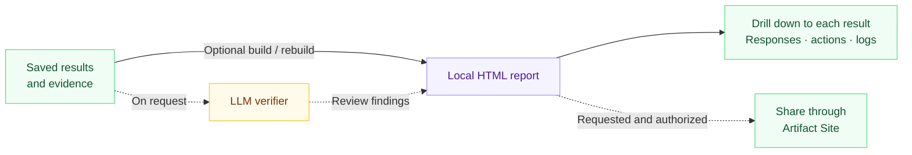

<div align="center">


**English** · [简体中文](docs/README.zh-CN.md)

[](https://github.com/lexmount/browser-eval/actions/workflows/ci.yml)
[](LICENSE)
[](pyproject.toml)

[Quickstart](#quickstart) · [Tracks](#evaluation-tracks) · [Approach](#evaluation-approach) · [Reports](#reports) · [Datasets and code](#datasets-and-code) · [Versions](#versions) · [Contributing](CONTRIBUTING.md)

</div>

Benchmark browsers and Web tools for AI agents through Web Fetch, Web Search and Browser Trajectory Replay. Compare correctness, latency, resource use and recorded cost. Optionally turn saved results into local reports you can inspect, rebuild and share, with drilldown to every individual result.

## Quickstart

Install [uv](https://docs.astral.sh/uv/getting-started/installation/), then run the offline example:

```sh
git clone https://github.com/lexmount/browser-eval.git
cd browser-eval
uv sync --frozen
uv run --frozen browser-harness-eval validate
uv run --frozen browser-harness-eval run --delay 0
```

Open the report path printed in the terminal. The example has one expected pass and one expected failure; it needs no browser, Docker or API key. Python 3.11 or newer is required; CI tests 3.11.

Next, [try HTTP, Moli or Chromium on a local article](examples/web_fetch/README.md). Optional adapters, service credentials and live evaluation commands are covered in the track guides.

## Evaluation tracks

Choose a workflow for its task contract, setup and runnable example.

| Track | Benchmarks and task suites | Guide |
| --- | --- | --- |
| Web Fetch | [LexBench-Web-Fetch](https://huggingface.co/datasets/Lexmount/LexBench-Web-Fetch), [LexBench-WebMainBench](https://huggingface.co/datasets/Lexmount/LexBench-WebMainBench), [LexBench-WCXB](https://huggingface.co/datasets/Lexmount/LexBench-WCXB) | [Local example](examples/web_fetch/README.md) · [Full guide](src/harness/web_fetch/README.md) |
| Web Search | [LexBench-Web-Search](https://huggingface.co/datasets/Lexmount/LexBench-Web-Search): scenario queries and [LexBench-SimpleQA-Verified](https://huggingface.co/datasets/Lexmount/LexBench-SimpleQA-Verified) retrieval tasks | [Local example](examples/web_search/README.md) · [Full guide](src/harness/web_search/README.md) |
| Browser Trajectory Replay | [LexBench-Headless-Browser](https://huggingface.co/datasets/Lexmount/LexBench-Headless-Browser) scenarios; [curated fixed-action tasks](https://huggingface.co/datasets/Lexmount/LexBench-Trajectory-Replay) with explicit checks; [WebArena replay](https://huggingface.co/datasets/Lexmount/LexBench-WebArena-Replay) with the official evaluator | [Headless inputs and upstream runner](https://huggingface.co/datasets/Lexmount/LexBench-Headless-Browser#execute-with-the-original-runner) · [Curated suite](examples/trajectory_replay/README.md) · [WebArena replay](examples/trajectory_replay/public_webarena/README.md) |

Use these suites or [bring your own tasks](docs/benchmarks.md). Add browsers and tools through the existing [adapter contracts](docs/provider-contract.md).

Experimental [Browser Use](examples/browser_use/README.md) gives an Agent a task, lets it choose browser actions, and checks the recorded outcome with the task evaluator. It includes model and planning variation and is evaluated separately.

<details>
<summary>How each evaluation workflow runs</summary>

### Web Fetch

The reusable ten-method Web Fetch cohort is selected with `--providers configured --provider-config configs/providers.example.json`; shared defaults are 30 seconds per call and one failure retry. See the [provider contract](docs/provider-contract.md#selected-native-cohort).



### Web Search



Relevance grading is scoring; optional verification reviews the resulting evidence and scores.

### Browser Trajectory Replay

#### Headless scenarios and comparison reports

Headless scenario replay checks browser/driver compatibility on local fixtures. For retained Headless comparisons, the upstream runner owns execution and grading; Browser Eval builds reports from its results. The original benchmark also contains individual CDP and Web-platform probes, so not every task is a multi-step trajectory.



#### WebArena



Task completion is checked in code, without an LLM judge.

#### Repository-curated tasks



</details>

## Evaluation approach

Browser Eval aims for stable, reproducible results and a controlled, trustworthy evaluation process. Three principles guide the evaluation.

1. **Prefer definite answers and programmatic scoring wherever possible, with minimal reliance on LLMs as judges**

    When a task has clear answers and acceptance criteria, use code to check the result and reduce variation from model judgment. This does not exclude LLM judges entirely: graded Web Search relevance is a suitable use, with an explicit rubric and retained scoring evidence and grades.

2. **Do not introduce LLMs or Agents to execute the evaluation**

    Web Fetch and Web Search call tools directly; trajectory replay follows predetermined actions to check browser compatibility or website task completion. Participants follow the same task contracts, avoiding extra variation from LLM decisions and Agent planning. Each run retains its task inputs, code revisions and execution settings.

3. **Make results easy to review and verify**

    Use an LLM as a verifier to add a check of programmatic verdicts and their supporting evidence. Trigger verification only on request; it does not run by default. Generate local HTML reports with drilldown from aggregate metrics to every individual result, including raw responses, action traces, logs and scoring evidence. Reviewing every result manually is expensive, so reports must also support human sampling. Upload to Artifact Site only when publication is requested and authorized.

See [evaluation design](docs/benchmarks.md#evaluation-design) for detailed scoring and verification requirements.

## Reports

Results and evidence are saved locally under `~/.browser-eval/runs/`; use `--output /absolute/path/new-run` to choose another directory. HTML reports include comparisons, task results, full responses and failure evidence. Local evaluation, scoring and HTML inspection need no Artifact Site account or publishing authorization.

The `run` command builds a local report by default. Add `--no-report` to save results without HTML; `rescore --no-report` updates scores without rebuilding HTML. Build or rebuild a report later from saved evidence without repeating calls:

```sh
uv run --frozen browser-harness-eval run --delay 0 --no-report
uv run --frozen browser-harness-eval report /absolute/path/to/run
```

English is the default; add `--language zh` when running or rebuilding for Chinese. A rebuild without that option keeps the saved language.

### Optional sharing

When sharing is requested and publication is authorized, open Artifact Site ([Global .com](https://yours.lexmount.com/artifact-site) · [China .cn](https://yours.lexmount.cn/artifact-site)), install the skill offered there, and follow it to publish the local report and choose who can access it. Uploading is a separate action; creating a local report does not publish it.

Scoring code ships with Browser Eval; dataset commits and file hashes are selected in [the data lock](src/harness/benchmarks/data-lock.json). Each report records its Browser Eval build and selected benchmark edition. See [versioning](docs/benchmarks.md#benchmark-editions) for comparison rules, [reference inputs](docs/reference-inputs.md) for historical data, and the [report guide](docs/report-hosting.md) for local builds and formal releases.

<details>
<summary>Report drilldown, rebuilding and sharing</summary>



Rebuild from valid saved evidence without new participant calls. Verification adds review findings and does not automatically replace scores.

</details>

## Datasets and code

<details>
<summary>Hugging Face datasets</summary>

These links provide versioned tasks, acceptance contracts and reference inputs.

| Dataset | Role |
| --- | --- |
| [LexBench-Web-Fetch](https://huggingface.co/datasets/Lexmount/LexBench-Web-Fetch) | Versioned Web Fetch tasks, acceptance contracts and reference bindings |
| [LexBench-Web-Search](https://huggingface.co/datasets/Lexmount/LexBench-Web-Search) | Scenario search queries and source references; factual QA is provided by SimpleQA Verified |
| [LexBench-WebMainBench](https://huggingface.co/datasets/Lexmount/LexBench-WebMainBench) | Reference-corrected WebMainBench tasks and correction provenance |
| [LexBench-SimpleQA-Verified](https://huggingface.co/datasets/Lexmount/LexBench-SimpleQA-Verified) | Length-qualified SimpleQA Verified retrieval tasks, with original answers |
| [LexBench-WCXB](https://huggingface.co/datasets/Lexmount/LexBench-WCXB) | Source-qualified frozen extraction inputs and references |
| [LexBench-Headless-Browser](https://huggingface.co/datasets/Lexmount/LexBench-Headless-Browser) | Executable CDP, driver and web-platform tasks; scenario specifications retained as source inputs |
| [LexBench-Trajectory-Replay](https://huggingface.co/datasets/Lexmount/LexBench-Trajectory-Replay) | 30 tasks written in Browser Eval for live public websites, with fixed actions and exact checks |
| [LexBench-WebArena-Replay](https://huggingface.co/datasets/Lexmount/LexBench-WebArena-Replay) | Full official task catalog; smaller replay editions retained as versioned source inputs |

Browser Eval wrote the 30 public-web replay tasks. Headless scenario designs informed some interactions; its executable cases and WebArena's tasks are not included in that suite. The task JSON fixes actions and expected outputs, while the target websites remain live.

</details>

<details>
<summary>Evaluation code and upstream sources</summary>

Web Fetch and Web Search scoring code lives in this repository under [src/lexbench_webfetch/](src/lexbench_webfetch/) and [src/lexbench_websearch/](src/lexbench_websearch/). Install and run it through the quickstart above.

| Component | Purpose | Code or source |
| --- | --- | --- |
| Headless Browser | Original CDP, driver and local-fixture runner | [Original repository](https://github.com/lexmount/Lexbench-Headless-Browser) |
| WebMainBench | Pinned extraction scorer and upstream attribution | [Maintained fork](https://github.com/lexmount/WebMainBench/tree/lex-main) · [Upstream](https://github.com/opendatalab/WebMainBench) |
| WebArena-Verified | Official evaluator for replay and experimental Agent integration | [Maintained fork](https://github.com/lexmount/webarena-verified/tree/lex-main) · [Upstream](https://github.com/ServiceNow/webarena-verified) |
| WCXB | Original data source for the qualified HF edition | [Upstream](https://github.com/Murrough-Foley/web-content-extraction-benchmark) |

[Dependency sources and pins](docs/dependencies.md) cover Playwright, extraction libraries and supporting runtimes. [Third-party notices](THIRD_PARTY.md) cover attribution and data rights. Cite the benchmark and upstream data used alongside Browser Eval.

</details>

<details>
<summary>Browsers and tools</summary>

| Project | Type | Use |
| --- | --- | --- |
| [Moli](https://github.com/lexmount/moli) | Browser | Evaluated through the same task contracts as other participants |
| [WebFetch CLI](https://github.com/lexmount/webfetch-cli) | CLI client | Calls the Lexmount WebFetch service |
| [CowAgent](https://github.com/zhayujie/CowAgent) | Agent framework | Web Fetch tool baseline and experimental Agent integration |
| [OpenClaw](https://github.com/openclaw/openclaw) | Agent framework | Web Fetch tool baseline and experimental Agent integration |
| [DeepSeek Harness](https://github.com/deepseek-ai/deepseek-harness) | Agent framework | Web Fetch tool baseline and experimental Agent integration |

</details>

## Versions

Published versions, changes and dependency snapshots are listed in [GitHub Releases](https://github.com/lexmount/browser-eval/releases). See [version rules](docs/releases.md) for release policy and report provenance.

## Contribute

Read [CONTRIBUTING](CONTRIBUTING.md) for code ownership, tests and PR conventions, or [open an issue](https://github.com/lexmount/browser-eval/issues) with a reproducible example.

```sh
make setup-test
make ci
```

[Architecture](docs/architecture.md) · [Security](SECURITY.md) · [Third-party content](THIRD_PARTY.md) · [Apache 2.0](LICENSE)

## Saved multi-suite reports

Use `scripts/build_report.py --saved-matrix /absolute/input-spec.json --output /absolute/new-report --language zh` to display saved results across suites.

Final presentation requires verified settings for every displayed method/family,
including unchanged and completion-only groups. Request options must be uniform
within each declared input class; DNS, timeout and retry budgets must also agree
across methods in a family. Unknown settings and adapter-rejected positions block
the final view. The methodology table exposes settings and collection dates;
equal settings do not establish a shared measurement window. Post-outcome
parameter selection and changed task prompts belong in separate audit reports,
not the primary original-contract ranking. Saved records are never rewritten to
make historical cohorts comparable.

- The hash-bound specification declares datasets, providers, selected results and evidenced missing outcomes. Suite-qualified identities preserve original cases and scores. No provider calls, rescoring or certification are added.
- This mode uses the existing Web Fetch renderer, including datasets, method pages and result/reference comparisons. Missing outcomes have a separate inventory. Keep the HTML pages and evidence directories together.
- Optional `report_families` lists ordered `{id, label}` entries for every observed task family. It groups the presentation by task content (including embedded media versus direct files), while preserving suite-qualified evidence identities and all saved scores.
- A family may set `task_family` and `source_suites` to keep independently frozen populations separate. Selectors must partition all cases exactly once. Set `combined_ranking: false` when cross-population aggregation is not meaningful; the summary then shows per-group results without a combined pass-rate column or rank.
- Optional `offline_revision` binds a revision `root` and a path/hash `receipt` produced by the existing local revision owner. Its complete predecessor cases and results must match this matrix. The report preserves original rules/results beside revised scores and labels the offline change. Optional `review_files` maps attachment names to JSON path/hash bindings; no provider calls occur during assembly.
- To fill previously uncalled positions after an offline revision, add new evidence to `sources`, remove the corresponding `missing` entries, and bind `completion.baseline_matrix`, `completion.baseline_audit`, and `completion.contract` by path and hash. The baseline audit binds the complete population and retained case/result bytes; unrelated calls and tasks cannot change. Separately verified offline revisions and whole-group parameter selection remain explicit exceptions. The pre-call contract declares `created_at`, `provider`, the total `cases`, and `jobs` with `suite` and `case_ids`. Every declared result must be present, newer than its contract, and previously uncalled. The frozen revision retains its original call population; completion cannot replace those calls.
- Multiple completion rounds use `completions`, an array of the same bindings with disjoint scopes. A shared-suite contract may declare `providers` and `case_ids`, with `suite` on the completion entry. An optional `note` appears on each completed result detail; it must describe the bound evidence, including any historical DNS difference; disclosure cannot waive uniformity checks.
- `excluded_report_families` removes complete named families from report rows, pages and statistics while retaining the full bound source population and historical parameter-selection scope. Exclusions must be unique known family IDs and cannot remove every family.
- `excluded_report_providers` similarly removes whole methods from the report while preserving the complete original scoring receipts. Other methods retain their selected records; rankings and totals are recomputed on the reported population. Unknown, duplicate, or all-method exclusions are rejected.
- All supersessions, including uncommitted replacement calls, require a hash-bound `execution_contract` on the scope or individual cell. The loader checks the authorized native settings and complete retry sequence before admitting a replacement. Uncommitted replacements also require observed configuration/timeout/call-count fields and a hash-bound `execution_log`; each `http_request_started` event identifies the provider, case, start time, configuration digest and timeout. Missing observations or inconsistent logs reject the replacement without inventing scores or elapsed time.
- `adoptions` binds a saved-matrix specification and `user_selected_complete_report_groups` authority for explicitly selected provider/family pairs. It replaces each complete visible group regardless of pass count, retains the previous calls as history, and verifies task/scorer identity. It cannot overlap parameter candidates or another adoption. Bind `execution_contract` for a shared execution policy, or disjoint `execution_contracts` entries with `suite`, `provider`, `case_ids` and `contract` covering every adopted call. Native settings and retry chronology are checked against the original acquisition records; later offline scoring does not rewrite historical retry decisions.
- Parameter comparisons require matching scoring provenance, the authorized provider configuration, actual native request receipts, and complete failure-retry sequences. Different scorers require a separate explicit offline revision before comparison. Replacement scopes and split retries must have valid pre-call chronology. The portable checker rejects unlisted files and symlinks, including additions beneath evidence directories.
- For displayed-category comparisons, set `parameter_reruns.selection` to `replace_family_if_pass_count_improves`. Candidate completeness and pass counts use the same `report_families` partition as the report, including families spanning execution tracks. Verified native settings must be uniform within each eligible group; ineligible groups cannot win by score. Each family is selected independently and ties retain an eligible baseline. Historical `replace_track_if_pass_count_improves` contracts retain their original track-wide population; changing that frozen selection requires an explicitly bound selection amendment.
- Adoption also compares verified native request settings, DNS, timeout and retry allowance within each displayed family, including retained retry calls. Numeric values such as `30` and `30.0` are equivalent. Method- or case-specific `configuration_exceptions` are rejected: an authority cannot relabel different settings as equivalent. Historical differences remain in the evidence but cannot qualify a mixed group for uniform comparison. Individual cases cannot be selected by their score.
- Check portable report files with `scripts/build_report.py --check-saved-matrix /absolute/new-report`. Add `--source-spec /absolute/input-spec.json` to also verify original evidence. Source paths are resolved beside that external specification; the report audit contains only names and hashes.
- Keep complete suite definitions when selecting methods and bind a receipt for every skipped cell. Retain physical retries for each selected logical result. Current-only selection does not establish why earlier results were replaced; corrections still require disclosure of scope and score, denominator and latency effects. Instance specifications, captures and HTML remain outside Git.


## Cite Browser Eval

Project citation: [CITATION.cff](CITATION.cff).

```bibtex
@software{browser_eval_2026,
  author = {{Browser Eval contributors}},
  title = {Browser Eval: Benchmarking Browsers and Web Tools for AI Agents},
  note = {Evaluation harness},
  year = {2026},
  url = {https://github.com/lexmount/browser-eval}
}
```
