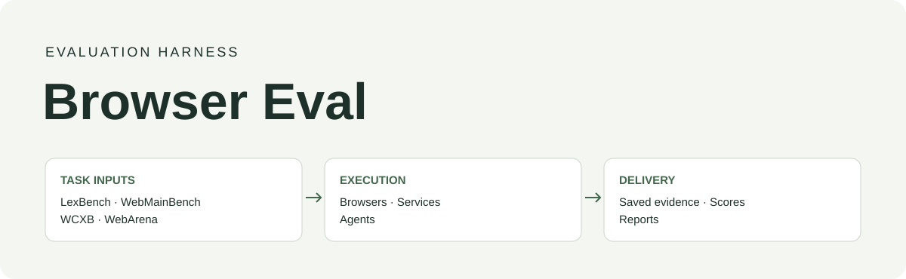
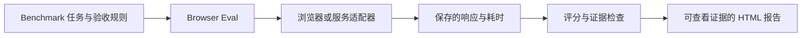

<div align="center">



# Browser Eval

### 执行同一组任务，留下可核查的证据。

用于网页抓取、固定浏览器操作和自主 Agent 的评测脚手架。

[English](../README.md) · **简体中文**

[](https://github.com/lexmount/browser-eval/actions/workflows/ci.yml)
[](../LICENSE)
[](../pyproject.toml)

[快速开始](#快速开始) · [Benchmark 接入](benchmarks.md) · [报告](#查看与分享报告) · [参与贡献](../CONTRIBUTING.md)

</div>

---

Browser Eval 把 benchmark 任务接到浏览器或服务适配器上，执行预先声明的比较，调用 benchmark 评分器检查保存的输出，并生成可查看证据的报告。它支持 Web Fetch、轨迹重放和 Browser Use；任务范围和验收要求由所选 benchmark 决定。

自建的 Web Fetch 任务集由 [LexBench Web Fetch](https://github.com/lexmount/lexbench-webfetch) 维护。WebMainBench、WCXB 和 WebArena 提供其他评测输入。Browser Eval 负责执行与报告，各 benchmark 分别维护范围、版本和来源说明。详见[仓库分工与接入](benchmarks.md)。

运行后得到 HTML 报告，里面有比较表、任务详情、响应和日志。可以在本地查看，也可以通过 [Artifact Site](https://github.com/lexmount/artifact-site) 发布，让其他人在线查看结果。

[评测内容](#评测内容) · [快速开始](#快速开始) · [查看与分享报告](#查看与分享报告) · [相关项目](#相关仓库导航) · [参与贡献](#参与贡献)



## 评测内容

支持以下执行方式：

| 轨道 | 回答什么问题 | 从这里开始 |
| --- | --- | --- |
| Web Fetch | 能否返回任务要求的正文、记录、资源或文件？需要多久？ | [本地示例](../examples/web_fetch/README.md) · [完整说明](../harness/web_fetch/README.md) |
| Browser Trajectory Replay（轨迹重放） | 不同浏览器能否完成同一组已记录的操作？消耗多少资源？ | [项目任务集](../examples/trajectory_replay/README.md) · [WebArena 人工轨迹](../examples/trajectory_replay/public_webarena/README.md) |
| Browser Use | 只更换浏览器时，Agent 能否完成任务？ | [CowAgent + WebArena 说明](../examples/browser_use/README.md) |

各轨道分别报告任务范围和分数。HTTP 是抓取基线；轨迹重放执行固定操作；Browser Use 包含 Agent 决策。

<details>
<summary>支持的浏览器、服务和工具</summary>

| 轨道 | 已实现的参与方 | 准备条件 |
| --- | --- | --- |
| Web Fetch：本地浏览器 | Moli、Chromium、Lightpanda、Obscura | 安装所选浏览器；Chromium 还需要 Playwright 和 Node.js 转换依赖 |
| Web Fetch：服务 | Lexmount、Firecrawl、Tavily Extract、Exa Contents、Cloudflare Markdown/Content；通过 Cloudflare 调用托管 Kitesurf | 供应商账户；凭据写入仓库 `.env` |
| Web Fetch：Agent 工具与提取库 | CowAgent、OpenClaw、DeepSeek Harness、LangChain WebBaseLoader、Crawl4AI | 按适配器要求准备上游源码、运行环境或 `oss-eval` 依赖 |
| 轨迹重放 / Browser Use | 当前浏览器注册表中的 Moli、Chromium | Docker/Linux 环境；Browser Use 还需要 CowAgent 和模型账户 |
| 对照方法 | 普通 HTTP、离线 fixture | 基础 Python 安装 |

各方法支持的任务类型不同，选择前请查看[适配器要求](../docs/provider-contract.md)和[依赖版本](../docs/dependencies.md)。

</details>

<details>
<summary>Benchmark 与数据集</summary>

| 任务集 | 评测内容 | 可用条件与入口 |
| --- | --- | --- |
| 离线 fixture / 本地文章 | 检查运行、任务选择、评分和证据，不提供性能排名 | 随仓库提供，命令见下文 |
| LexBench Web Fetch | 普通网页、动态内容、文档、图片/视频、热门网站、访问限制 | [Benchmark 仓库](https://github.com/lexmount/lexbench-webfetch) · [接入说明](benchmarks.md)；完整历史参考需要获准使用的外部输入 |
| WebMainBench / WCXB | 独立绑定的冻结 HTML 与参考内容上的提取质量 | [冻结 HTML 说明](../harness/web_fetch/WEBMAINBENCH.md)；按原数据许可获取输入，并使用对应认证流程 |
| 项目维护的轨迹任务集 | 在指定公开网页上执行相同固定操作 | [轨迹运行说明](../examples/trajectory_replay/README.md)；需要 Docker 和网站访问 |
| WebArena 人工轨迹重放 | 自建网站上的已通过资格检查的固定轨迹与官方任务评估 | [复现说明](../docs/webarena-fixed-trajectory-reproduction.md)；需要外部数据和较多部署资源 |
| WebArena-Verified Browser Use | CowAgent 自主完成任务，由官方评估器判定 | [Browser Use 说明](../examples/browser_use/README.md)；任务范围和环境分别声明 |

Web Fetch CLI 使用数据集文件；轨迹重放和 Browser Use 使用各自的执行入口。

</details>

## 快速开始

克隆仓库，在根目录打开终端，安装 [uv](https://docs.astral.sh/uv/getting-started/installation/)。基础 CLI 支持 Python 3.11–3.14，仓库开发默认使用 3.11。

```bash
uv sync --frozen
uv run --frozen browser-harness-eval validate
uv run --frozen browser-harness-eval run --delay 0
```

打开终端打印的报告路径。这个离线示例无需浏览器、Docker 或 API Key，预设一个通过结果和一个失败结果，方便查看两种情况。安装依赖时需要联网。

接下来，可以[用 HTTP、Moli 或 Chromium 抓取本地文章](../examples/web_fetch/README.md)。说明中包含浏览器安装、多方法比较和自选任务。远程服务和 Agent 运行需要相应账户，调用可能产生费用。

<details>
<summary>选择其他 Python 版本或安装可选适配器</summary>

使用 Python 3.12 时，在 `uv sync --frozen` 和后续 `uv run --frozen` 命令中都加上 `--python 3.12`。可选适配器和历史实验另有版本要求，完整开发环境使用 3.11。

| 额外依赖 | 用途 |
| --- | --- |
| `headless-eval` | Chromium、PDF 解析和容器测量 |
| `webmainbench-eval` | WebMainBench 评分 |
| `browser-use-eval` | WebArena 和 Agent；安装固定提交的评估器需要 Git |
| `oss-eval` | 开源提取库 |

用 `uv sync --frozen --extra NAME` 安装。浏览器、Docker、网站数据和账户分别准备，见[依赖说明](../docs/dependencies.md)。

</details>

## 查看与分享报告

| 输出 | 内容 |
| --- | --- |
| `report/en/index.html` | 英文比较、任务结果和证据入口 |
| `report/index.html` | 报告入口，打开所选语言 |
| `results.jsonl`、`summary.json` | 供程序分析的评分和汇总 |
| `manifest.json`、`dataset.json` | 使用的方法、版本、设置和任务 |
| `artifacts/` | 保存的响应及其他证据 |

默认保存在 `~/.browser-eval/runs/`。用 `BROWSER_EVAL_DATA_HOME` 改数据根目录，或用 `--output /absolute/path/new-run` 指定本次输出。每次运行需要一个新目录。

从保存的证据重建报告，无需再次调用浏览器或 API：

```bash
uv run --frozen browser-harness-eval report /absolute/path/to/run
```

Web Fetch 命令默认打开英文报告，并保留可切换的中文版。开始评测时可以选中文，也可以更改已有报告的语言：

```bash
uv run --frozen browser-harness-eval run --delay 0 --language zh
uv run --frozen browser-harness-eval report /absolute/path/to/run --language en
```

重建时不传 `--language`，会沿用上次的选择。切换语言不重新调用浏览器或服务，也不改变评分；任务原文、响应和日志保留原来的语言。目前支持英文（`en`）和中文（`zh`），其他语言代码会报错。独立构建器和历史报告的支持范围见[报告语言说明](report-hosting.md#report-languages)。

冻结的本地报告使用随证据保存的 `presentation-binding.json`。报告专用配置和发布目标保存在 Git 之外，与该报告的证据放在一起。按照[冻结本地报告流程](../harness/web_fetch/README.md#frozen-local-report-inputs)检查或重建，不改变保存的评分。

在线发布：

1. 在[中国站](https://artifact-site.lexmount.cn/)或[全球站](https://yours.lexmount.com/artifact-site)登录或创建账户。
2. 按 [CLI 或 MCP 说明](../docs/report-hosting.md)发布本次运行的 `report/` 目录。
3. 在分享设置中选择谁能访问报告。

[Artifact Site](https://github.com/lexmount/artifact-site) 已开源，支持自行部署、报告版本管理和访问权限。本地报告无需托管账户，也不会自动上传。

示例运行生成诊断报告。正式 benchmark 发布需要通过所选轨道的认证和发布检查；上传报告本身不代表结果已通过认证。

## 相关仓库导航

| 仓库 | 在这项工作中的用途 |
| --- | --- |
| [LexBench Web Fetch](https://github.com/lexmount/lexbench-webfetch) | 自建 Web Fetch 评测使用的独立任务集和验收规则 |
| [Moli](https://github.com/lexmount/moli) | 与其他实现一起接受评测的浏览器 |
| [Artifact Site](https://github.com/lexmount/artifact-site) | 报告托管、版本管理和分享，支持自行部署 |
| [Lexbench-Headless-Browser](https://github.com/lexmount/Lexbench-Headless-Browser) | 独立评测浏览器协议、自动化驱动和 Web 平台语义 |
| [WebArena-Verified fork](https://github.com/lexmount/webarena-verified/tree/lex-main) | Browser Use 与公开 WebArena 重放的任务和评估器，在 `lex-main` 维护 |
| [WebMainBench fork](https://github.com/lexmount/WebMainBench/tree/lex-main) · [上游](https://github.com/opendatalab/WebMainBench) | 冻结 HTML 的正文提取 benchmark；fork 维护已声明的评分修正 |
| [WCXB](https://github.com/Murrough-Foley/web-content-extraction-benchmark) | 独立的网页正文提取 benchmark |
| [CowAgent](https://github.com/zhayujie/CowAgent) | Browser Use 的 Agent 执行器和 Web Fetch 工具基线 |
| [OpenClaw](https://github.com/openclaw/openclaw) · [DeepSeek Harness](https://github.com/deepseek-ai/deepseek-harness) | Web Fetch 工具基线 |

具体版本见[依赖来源与固定提交](../docs/dependencies.md)，按所选方法安装需要的组件即可。

## 参与贡献

欢迎为适配器、执行修复、测试、文档和翻译提交 PR。LexBench 任务要求的修改请提交到 [LexBench Web Fetch](https://github.com/lexmount/lexbench-webfetch)。先看[贡献指南](../CONTRIBUTING.md)，或提交带有复现示例的 [issue](https://github.com/lexmount/browser-eval/issues)。

```bash
make setup-test
make ci
```

历史网页和测量输出保存在 Git 之外。复现历史运行见[参考输入](../docs/reference-inputs.md)，代码结构和发布内部流程见[架构说明](../docs/architecture.md)。

项目代码采用 [MIT 许可](../LICENSE)。数据权利和署名见[第三方说明](../THIRD_PARTY.md)，凭据和不可信内容处理见[安全说明](../SECURITY.md)。

## 引用 Browser Eval

在公开作品中使用本脚手架时，请引用仓库，并记录实际使用的 tag 或提交。任务定义与评测方法请另行引用 LexBench Web Fetch 或对应 benchmark。GitHub 的引用入口读取 [CITATION.cff](../CITATION.cff)。首个版本可这样引用：

```bibtex
@software{browser_eval_2026,
  author = {{Browser Eval contributors}},
  title = {Browser Eval},
  year = {2026},
  version = {0.1.0},
  url = {https://github.com/lexmount/browser-eval}
}
```

使用上游 benchmark 的数据、评估器或方法时，还应分别引用原项目；引用本仓库不能代替上游的署名要求。
