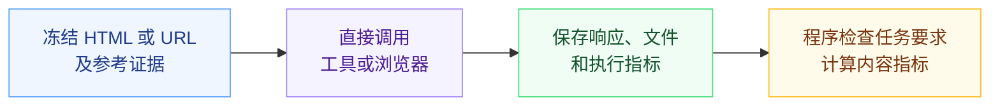
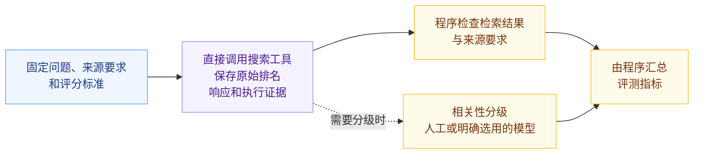
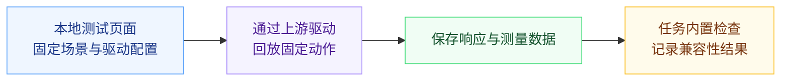
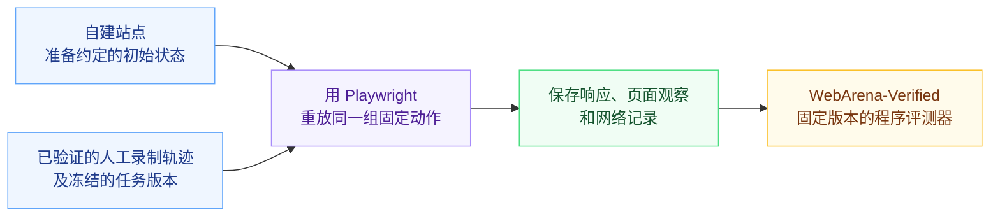
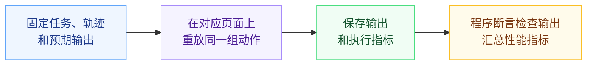
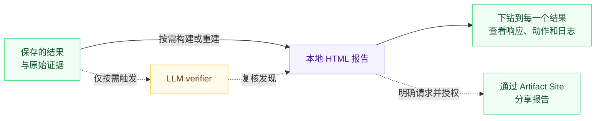

<div align="center">


[English](../README.md) · **简体中文**

[](https://github.com/lexmount/browser-eval/actions/workflows/ci.yml)
[](../LICENSE)
[](../pyproject.toml)

[快速开始](#快速开始) · [评测流程](#评测流程) · [设计原则](#设计原则) · [报告](#报告) · [数据集与代码](#数据集与代码) · [版本](#版本) · [参与贡献](../CONTRIBUTING.md)

</div>

面向 AI Agent，评测浏览器与 Web 工具，覆盖内容抓取、搜索和Browser Trajectory Replay。比较正确性、延迟、资源使用和已记录的成本，并可按需将保存的结果生成本地报告，下钻检查每一个结果，重建或分享报告。

## 快速开始

安装 [uv](https://docs.astral.sh/uv/getting-started/installation/)，运行离线示例：

```sh
git clone https://github.com/lexmount/browser-eval.git
cd browser-eval
uv sync --frozen
uv run --frozen browser-harness-eval validate
uv run --frozen browser-harness-eval run --delay 0
```

打开终端打印的报告路径。示例包含一个预期通过和一个预期失败，无需浏览器、Docker 或 API 密钥。支持 Python 3.11–3.14，仓库开发使用 3.11。

接下来可以[用 HTTP、Moli 或 Chromium 读取本地文章](../examples/web_fetch/README.md)。可选适配器、服务凭据和在线评测命令见上面的各流程指南。

## 评测流程

按任务选择评测流程，各指南提供任务约定、环境配置和可运行示例。

| 流程 | 对应评测集与任务集 | 使用指南 |
| --- | --- | --- |
| Web Fetch | [LexBench-Web-Fetch](https://huggingface.co/datasets/Lexmount/LexBench-Web-Fetch)、[LexBench-WebMainBench](https://huggingface.co/datasets/Lexmount/LexBench-WebMainBench)、[LexBench-WCXB](https://huggingface.co/datasets/Lexmount/LexBench-WCXB) | [本地示例](../examples/web_fetch/README.md) · [完整指南](../src/harness/web_fetch/README.md) |
| Web Search | [LexBench-Web-Search](https://huggingface.co/datasets/Lexmount/LexBench-Web-Search)：场景问题，以及 [LexBench-SimpleQA-Verified](https://huggingface.co/datasets/Lexmount/LexBench-SimpleQA-Verified) 检索任务 | [本地示例](../examples/web_search/README.md) · [完整指南](../src/harness/web_search/README.md) |
| Browser Trajectory Replay | [LexBench-Headless-Browser](https://huggingface.co/datasets/Lexmount/LexBench-Headless-Browser) 固定场景、[自建固定动作任务](https://huggingface.co/datasets/Lexmount/LexBench-Trajectory-Replay)使用显式断言；[WebArena Replay](https://huggingface.co/datasets/Lexmount/LexBench-WebArena-Replay)使用官方评测器 | [Headless 输入与上游运行器](https://huggingface.co/datasets/Lexmount/LexBench-Headless-Browser#execute-with-the-original-runner) · [自建任务集](../examples/trajectory_replay/README.md) · [WebArena Replay](../examples/trajectory_replay/public_webarena/README.md) |

可使用这些评测集，也可[接入自己的任务](benchmarks.md)。新的浏览器和工具通过已有[适配接口](provider-contract.md)接入。

实验性的 [Browser Use](../examples/browser_use/README.md) 则把任务交给 Agent，由它自行决定浏览器动作，再由任务评测器检查执行结果。它包含模型和规划带来的波动，因此单独评测。

<details>
<summary>展开各类评测的流程图</summary>

### Web Fetch

使用 `--providers configured --provider-config configs/providers.example.json` 选择可复用的十种 Web Fetch 方法；默认每次调用 30 秒，失败允许重试一次。详见[适配器规则](provider-contract.md#selected-native-cohort)。



### Web Search



相关性分级属于评分环节；按需复核则检查评分结果及其证据。

### Browser Trajectory Replay

#### Headless 场景与对比报告

Headless 通过在本地测试页面上回放固定场景，检查浏览器和驱动的兼容性。已有对比的任务执行与评分由上游运行器负责，Browser Eval 读取结果生成报告。原版 benchmark 还包含单项 CDP 和 Web 平台探针，并非每个任务都是多步轨迹。



#### WebArena



任务完成情况由程序验收，不使用 LLM judge。

#### 仓库自建任务



</details>

## 设计原则

我们希望评测结果稳定复现、过程可控、结论可信赖。为此，遵循以下三个原则。

1. **尽可能使用确定的答案，尽可能程序化评分，尽可能不依赖 LLM as a judge**

    有明确答案和验收条件的任务，尽可能用程序判断结果，减少模型判断带来的波动。但这不是完全排除 LLM as a judge：Web Search 的相关性分级就适合使用模型，前提是明确评分标准，并保留评分依据与结果。

2. **不引入 LLM 和 Agent 去执行评测过程**

    Web Fetch、Web Search 直接调用被测工具；Browser Trajectory Replay执行预先确定的动作，可用于检查浏览器兼容性或验证网站任务是否完成。让各个参与方按同样的任务约定执行，去掉额外的 LLM 决策和 Agent 规划这两个波动来源，并保留任务输入、代码版本和执行配置。

3. **方便审查，可校验**

    用 LLM as a verifier 对程序判定及其依据多做一层校验，按需触发，默认不运行。生成本地 HTML 报告，支持从汇总指标下钻到每一个结果，查看原始响应、操作轨迹、日志和评分依据。100% 人工审查成本高，因此也要方便人工抽样审查。只有明确要求发布并授权后，才上传到 Artifact Site。

评分与复核的详细要求见[评测设计](benchmarks.md#evaluation-design)。

## 报告

结果和证据默认保存在本地 `~/.browser-eval/runs/`，也可用 `--output /absolute/path/new-run` 指定新目录。HTML 报告包含结果对比、逐题结果、完整响应和失败证据。本地评测、评分和查看 HTML 无需 Artifact Site 账号或发布授权。

`run` 默认生成本地报告。加 `--no-report` 可只保存结果；`rescore --no-report` 只重算评分，不重建 HTML。之后可从保存的证据生成或重建报告，无需重复调用浏览器或服务：

```sh
uv run --frozen browser-harness-eval run --delay 0 --no-report
uv run --frozen browser-harness-eval report /absolute/path/to/run
```

默认生成英文；运行或重建时加 `--language zh` 可选中文。重建时不传该选项，会沿用已保存的语言。

### 按需分享

明确要求分享并授权发布后，打开 Artifact Site（[全球站 .com](https://yours.lexmount.com/artifact-site) · [中国站 .cn](https://yours.lexmount.cn/artifact-site)），安装网站提供的 skill，按引导发布本地报告并设置访问权限。上传是独立操作，生成本地报告不会自动发布。

评分代码随 Browser Eval 安装；数据集提交和文件哈希由[数据锁文件](../src/harness/benchmarks/data-lock.json)指定。报告记录 Browser Eval 构建版本和选定的评测版本。结果比较规则见[版本说明](benchmarks.md#benchmark-editions)，历史数据见[参考输入](reference-inputs.md)，本地构建与正式发布要求见[报告指南](report-hosting.md)。

<details>
<summary>展开报告下钻、重建与分享流程</summary>



从仍然适用的已存证据重建报告，无需重新调用参与方。复核补充审查发现，不自动改写分数。

</details>

## 数据集与代码

<details>
<summary>Hugging Face 数据集</summary>

下列链接提供版本化题目、验收要求和参考输入。

| 数据集 | 用途 |
| --- | --- |
| [LexBench-Web-Fetch](https://huggingface.co/datasets/Lexmount/LexBench-Web-Fetch) | Web Fetch 题目、验收要求和参考输入绑定 |
| [LexBench-Web-Search](https://huggingface.co/datasets/Lexmount/LexBench-Web-Search) | 搜索场景问题和来源要求；事实问答由 SimpleQA Verified 提供 |
| [LexBench-WebMainBench](https://huggingface.co/datasets/Lexmount/LexBench-WebMainBench) | 修正参考答案后的 WebMainBench 任务及修订依据 |
| [LexBench-SimpleQA-Verified](https://huggingface.co/datasets/Lexmount/LexBench-SimpleQA-Verified) | 按输入长度筛选的 SimpleQA Verified 检索任务，保留原始答案 |
| [LexBench-WCXB](https://huggingface.co/datasets/Lexmount/LexBench-WCXB) | 已核验来源的冻结提取输入和参考答案 |
| [LexBench-Headless-Browser](https://huggingface.co/datasets/Lexmount/LexBench-Headless-Browser) | CDP、自动化驱动和 Web 平台的可执行任务；场景设计规格保留在原始文件中 |
| [LexBench-Trajectory-Replay](https://huggingface.co/datasets/Lexmount/LexBench-Trajectory-Replay) | Browser Eval 自建的 30 个公网任务，包含固定动作和确定性验收条件 |
| [LexBench-WebArena-Replay](https://huggingface.co/datasets/Lexmount/LexBench-WebArena-Replay) | 官方完整任务集；较小的Browser Trajectory Replay版本保留为版本化原始输入 |

这 30 个公网轨迹任务由 Browser Eval 自建，部分交互设计借鉴了 Headless 的场景规格，没有导入 Headless 或 WebArena 的完整任务。任务文件固定了动作和预期输出，线上网页仍可能变化。

</details>

<details>
<summary>评测代码与上游来源</summary>

Web Fetch 和 Web Search 的评分代码分别位于本仓库的 [src/lexbench_webfetch/](../src/lexbench_webfetch/) 和 [src/lexbench_websearch/](../src/lexbench_websearch/)，安装和运行见上文快速开始。

| 组件 | 用途 | 代码或来源 |
| --- | --- | --- |
| Headless Browser | 原始 CDP、驱动和本地测试站点的运行程序 | [原仓库](https://github.com/lexmount/Lexbench-Headless-Browser) |
| WebMainBench | 固定版本的提取评分器及上游署名 | [维护分支](https://github.com/lexmount/WebMainBench/tree/lex-main) · [上游](https://github.com/opendatalab/WebMainBench) |
| WebArena-Verified | 重放和实验性 Agent 集成使用的官方评测器 | [维护分支](https://github.com/lexmount/webarena-verified/tree/lex-main) · [上游](https://github.com/ServiceNow/webarena-verified) |
| WCXB | HF 核验版本的原始数据来源 | [上游](https://github.com/Murrough-Foley/web-content-extraction-benchmark) |

Playwright、提取库和配套运行环境的固定版本见[依赖说明](dependencies.md)，引用要求和数据权利见[第三方说明](../THIRD_PARTY.md)。引用 Browser Eval 时，也请引用实际使用的评测集与上游数据。

</details>

<details>
<summary>浏览器与工具</summary>

| 项目 | 类型 | 用途 |
| --- | --- | --- |
| [Moli](https://github.com/lexmount/moli) | 浏览器 | 按相同任务规则参与评测 |
| [WebFetch CLI](https://github.com/lexmount/webfetch-cli) | 命令行客户端 | 调用 Lexmount WebFetch 服务 |
| [CowAgent](https://github.com/zhayujie/CowAgent) | Agent 框架 | Web Fetch 工具基线和实验性 Agent 集成 |
| [OpenClaw](https://github.com/openclaw/openclaw) | Agent 框架 | Web Fetch 工具基线和实验性 Agent 集成 |
| [DeepSeek Harness](https://github.com/deepseek-ai/deepseek-harness) | Agent 框架 | Web Fetch 工具基线和实验性 Agent 集成 |

</details>

## 版本

已发布版本、变更和依赖见[发布记录](https://github.com/lexmount/browser-eval/releases)。升版规则与报告版本绑定见[版本说明](releases.md)。

## 参与贡献

代码归属、测试和 PR 规范见 [CONTRIBUTING](../CONTRIBUTING.md)。反馈问题请[提交可复现的示例](https://github.com/lexmount/browser-eval/issues)。

```sh
make setup-test
make ci
```

[代码结构](architecture.md) · [安全](../SECURITY.md) · [第三方内容](../THIRD_PARTY.md) · [Apache 2.0](../LICENSE)

## 引用 Browser Eval

项目引用：[CITATION.cff](../CITATION.cff)。

```bibtex
@software{browser_eval_2026,
  author = {{Browser Eval contributors}},
  title = {Browser Eval: Benchmarking Browsers and Web Tools for AI Agents},
  note = {Evaluation harness},
  year = {2026},
  url = {https://github.com/lexmount/browser-eval}
}
```
