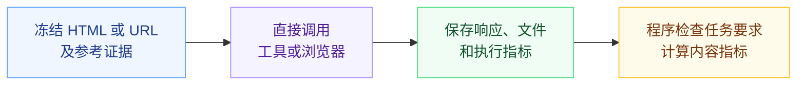
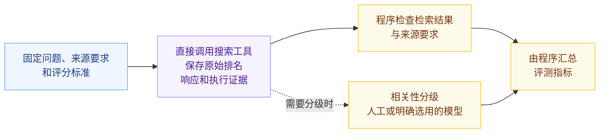
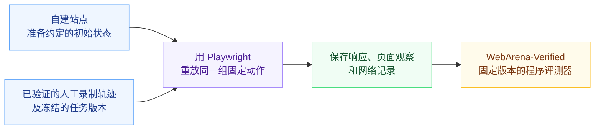
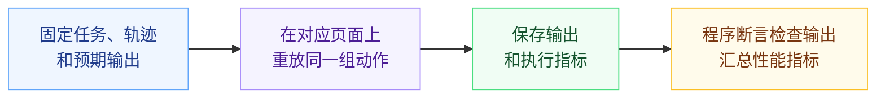
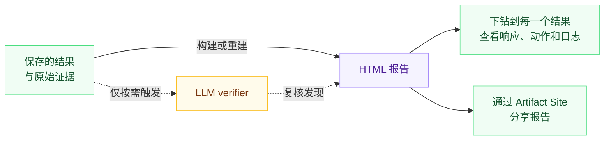

<div align="center">


<h3>Browser Eval：面向 AI Agent 的浏览器与 Web 工具评测</h3>

[English](../README.md) · **简体中文**

[](https://github.com/lexmount/browser-eval/actions/workflows/ci.yml)
[](../LICENSE)
[](../pyproject.toml)

[特性](#特性) · [设计原则](#结果稳定复现可控可信赖) · [评测流程](#评测流程) · [快速开始](#快速开始) · [报告](#报告) · [版本](#版本) · [相关仓库](#相关仓库) · [参与贡献](../CONTRIBUTING.md)

</div>

面向 AI Agent，评测浏览器与 Web 工具，覆盖 Web Fetch、Web Search 和浏览器轨迹重放。比较任务完成情况、延迟、资源使用和已记录的成本，把评测结果变成可以下钻检查、重建和分享的报告，并保留逐题证据。

## 特性

| 特性 | 能做什么 |
| --- | --- |
| 从评测到报告 | 配置任务和评测对象后，一条命令完成评测并生成 HTML 报告。 |
| 接入多种 benchmark | 使用已接入的 benchmark，也可提供自己的任务，按所选 benchmark 的规则评分。[接入指南](benchmarks.md) |
| 扩展评测对象 | 比较浏览器引擎、搜索 API、在线抓取服务和内容提取工具，通过已有[适配接口](provider-contract.md)接入新的参与方。 |
| 查看逐题证据 | 从汇总指标查看对应的逐题响应、操作轨迹和失败日志。 |
| 复用已有结果 | 从保存的输出重建报告、重算评分，无需重复调用参与方。 |
| 比较质量、性能和成本 | 同时查看任务通过情况、延迟、资源使用和已记录的计费数据。 |
| 追溯实验配置 | 保留任务输入、benchmark 和软件版本、评分代码及执行配置。 |
| 分享报告并控制权限 | 通过 Artifact Site 发布报告，并设置谁能访问。[创建与分享报告](#报告) |

## 结果稳定复现，可控可信赖

这是 Browser Eval 的核心设计目标。为此，我们在评测中遵循以下三个原则。

### 1. 尽可能使用确定的答案，尽可能程序化评分，尽可能不依赖 LLM as a judge

有明确答案和验收条件的任务，尽可能用程序判断结果，减少模型判断带来的波动。但这不是完全排除 LLM as a judge：Web Search 的相关性分级就适合使用模型，前提是明确评分标准，并保留评分依据与结果。

### 2. 不引入 LLM 和 Agent 去执行评测过程

Web Fetch、Web Search 直接调用被测工具；浏览器通过固定轨迹重放来评测，不通过 Browser Use 让 Agent 临时决定下一步。让各个参与方执行同样的任务，去掉评测执行中额外的 LLM 决策和 Agent 规划这两个波动来源。

### 3. 方便审查，可校验

用 LLM as a verifier 对程序判定及其依据多做一层校验，按需触发，默认不运行。生成 HTML 报告并上传到 Artifact Site，支持从汇总指标下钻到每一个结果，查看原始响应、操作轨迹、日志和评分依据。100% 人工审查成本高，因此也要方便人工抽样审查。

各任务的流程见下文，评分与复核的详细要求见[评测设计](benchmarks.md#evaluation-design)。

## 评测流程

按任务选择评测流程，各指南提供任务约定、环境配置和可运行示例。

| 流程 | 对应评测集与任务集 | 使用指南 |
| --- | --- | --- |
| Web Fetch | [LexBench Web Fetch](https://github.com/lexmount/lexbench-webfetch)、[WebMainBench](https://github.com/opendatalab/WebMainBench)、[WCXB](https://github.com/Murrough-Foley/web-content-extraction-benchmark) | [本地示例](../examples/web_fetch/README.md) · [完整指南](../harness/web_fetch/README.md) |
| Web Search | [LexBench Web Search](https://github.com/lexmount/lexbench-websearch)：场景问题，以及用于检索评测的 SimpleQA Verified 改编任务 | [本地示例](../examples/web_search/README.md) · [完整指南](../harness/web_search/README.md) |
| 轨迹重放 | [仓库自建固定动作任务集](../examples/trajectory_replay/README.md)，改编自 [Lexbench-Headless-Browser 场景设计](https://github.com/lexmount/Lexbench-Headless-Browser/tree/3f1580a20922fc3f339b5fc279d9bbdb06d5d194/tasks/scenarios)；[经过资格验证的 WebArena 人工录制轨迹](../evaluation/browser-use-public/webarena-human-suite.json)，由 [WebArena-Verified 评测器](https://github.com/lexmount/webarena-verified/tree/lex-main)验收 | [自建任务集](../examples/trajectory_replay/README.md) · [WebArena 重放](../examples/trajectory_replay/public_webarena/README.md) |

### Web Fetch



### Web Search



相关性分级属于评分环节；按需复核则检查评分结果及其证据。

### 浏览器轨迹重放

#### WebArena



任务完成情况由程序验收，不使用 LLM judge。

#### 仓库自建任务



### 下钻检查、重建与分享



从仍然适用的已存证据重建报告，无需重新调用参与方。复核补充审查发现，不自动改写分数。

实验性的 [Browser Use](../examples/browser_use/README.md) 则把任务交给 Agent，由它自行决定浏览器动作，再由任务评测器检查执行结果。它包含模型和规划带来的波动，因此单独评测。

## 快速开始

安装 [uv](https://docs.astral.sh/uv/getting-started/installation/)，运行离线示例：

```sh
git clone https://github.com/lexmount/browser-eval.git
cd browser-eval
uv sync --frozen
uv run --frozen browser-harness-eval validate
uv run --frozen browser-harness-eval run --delay 0
```

打开终端打印的报告路径。示例包含一个预期通过和一个预期失败，无需浏览器、Docker 或 API 密钥。支持 Python 3.11–3.14，仓库开发使用 3.11。

接下来可以[用 HTTP、Moli 或 Chromium 读取本地文章](../examples/web_fetch/README.md)。可选适配器、服务凭据和在线评测命令见上面的各流程指南。

## 报告

创建和分享报告，请打开 Artifact Site（[全球站 .com](https://yours.lexmount.com/artifact-site) · [中国站 .cn](https://yours.lexmount.cn/artifact-site)），安装网站提供的 skill，按引导创建、发布报告，并设置分享权限。

报告包含结果对比、逐题结果、完整响应和失败证据。运行结果默认保存在 `~/.browser-eval/runs/`，也可用 `--output /absolute/path/new-run` 指定新目录。

从保存的证据重建报告，无需重新调用浏览器或服务：

```sh
uv run --frozen browser-harness-eval report /absolute/path/to/run
```

默认生成英文；运行或重建时加 `--language zh` 可选中文。重建时不传该选项，会沿用已保存的语言。

新报告记录 Browser Eval 构建版本和选定的评测版本，并保留代码与输入哈希。结果比较规则见[版本说明](../docs/benchmarks.md#benchmark-editions)，历史数据见[参考输入](../docs/reference-inputs.md)。

本地构建与正式评测发布要求见[报告指南](report-hosting.md)。

## 版本

已发布版本、变更和依赖见[发布记录](https://github.com/lexmount/browser-eval/releases)。升版规则与报告版本绑定见[版本说明](releases.md)。

## 相关仓库

| 仓库 | 用途 |
| --- | --- |
| [LexBench Web Fetch](https://github.com/lexmount/lexbench-webfetch) | Web Fetch 题目、验收评分和冻结输入绑定 |
| [LexBench Web Search](https://github.com/lexmount/lexbench-websearch) | 搜索问题、来源参考和检索评分 |
| [Moli](https://github.com/lexmount/moli) | 与其他参与者按相同任务规则评测的浏览器 |
| [WebFetch CLI](https://github.com/lexmount/webfetch-cli) | Lexmount WebFetch 服务的命令行客户端 |
| Artifact Site（[全球站 .com](https://yours.lexmount.com/artifact-site) · [中国站 .cn](https://yours.lexmount.cn/artifact-site)） | 报告创建、分享和权限控制 |
| [Lexbench-Headless-Browser](https://github.com/lexmount/Lexbench-Headless-Browser) | 自建轨迹的场景设计来源；另有独立的协议、自动化驱动和 Web 平台评测 |
| [WebMainBench 分支](https://github.com/lexmount/WebMainBench/tree/lex-main) · [上游](https://github.com/opendatalab/WebMainBench) | 冻结 HTML 提取任务与有记录的评分修正 |
| [WebArena-Verified 分支](https://github.com/lexmount/webarena-verified/tree/lex-main) · [上游](https://github.com/ServiceNow/webarena-verified) | WebArena 轨迹重放及实验性 Agent 集成所用的题目与评测器 |
| [WCXB](https://github.com/Murrough-Foley/web-content-extraction-benchmark) | 独立的内容提取评测集 |
| [CowAgent](https://github.com/zhayujie/CowAgent)、[OpenClaw](https://github.com/openclaw/openclaw)、[DeepSeek Harness](https://github.com/deepseek-ai/deepseek-harness) | Web Fetch 工具基线和实验性 Agent 集成 |

Playwright、提取库和配套运行环境的来源与固定版本见[依赖说明](../docs/dependencies.md)，引用要求和数据权利见[第三方说明](../THIRD_PARTY.md)。引用 Browser Eval 时，也请引用实际使用的评测集与上游数据。

## 参与贡献

代码归属、测试和 PR 规范见 [CONTRIBUTING](../CONTRIBUTING.md)。反馈问题请[提交可复现的示例](https://github.com/lexmount/browser-eval/issues)。

```sh
make setup-test
make ci
```

[代码结构](../docs/architecture.md) · [安全](../SECURITY.md) · [第三方内容](../THIRD_PARTY.md) · [Apache 2.0](../LICENSE)

## 引用 Browser Eval

项目引用：[CITATION.cff](../CITATION.cff)。

```bibtex
@software{browser_eval_2026,
  author = {{Browser Eval contributors}},
  title = {Browser Eval: Benchmarking Browsers and Web Tools for AI Agents},
  note = {Evaluation harness},
  year = {2026},
  url = {https://github.com/lexmount/browser-eval}
}
```
