# Architecture

Browser Eval separates task definitions, browser execution, scoring and reports.
The three tracks share infrastructure, but keep their task populations, evaluator
contracts and publication targets separate.

| Track | Implementation | Running and reproduction |
| --- | --- | --- |
| Web Fetch | `harness/web_fetch/` | [Web Fetch guide](../harness/web_fetch/README.md), [frozen HTML comparisons](../harness/web_fetch/HEADLESS.md) |
| Browser Trajectory Replay | `harness/trajectory_replay/` | [Fixed-action examples](../examples/trajectory_replay/README.md) |
| Browser Use | `harness/browser_use/` | [Autonomous Agent examples](../examples/browser_use/README.md) |

Public WebArena human-recording replay is isolated under
`harness/trajectory_replay/public_webarena/` with its [own examples and release
contract](../examples/trajectory_replay/public_webarena/README.md).
`harness/lexbench/` adapts retained Lexbench comparisons; it does not define a
fourth browser score or replace a track's execution and evaluator contracts.

## Data flow

```mermaid
flowchart LR
    A[Task and method profiles] --> B[Freeze and validate inputs]
    B --> C[Collect physical calls]
    C --> D[Verify post-call inputs]
    D --> E[Certify complete declared cohort]
    E --> F[Score authoritative logical results]
    F --> G[Build report from bound evidence]
    G --> H[Check and package declared public files]
    H --> I[Publish and verify deployed bytes]
```



Ordinary `run` output is diagnostic evidence. A certified runner fixes the task
scope, method identities and references before calls, then checks them afterward.
Incomplete or changed cohorts do not receive a valid certificate. Independent
result review is a separate, explicitly requested operation; certification is
not a substitute for human review.

Each logical result selects the response specified by its retry policy, usually
the final physical call. All physical calls and their costs remain in the
evidence chain. Scoring reads persisted output, so a report rebuild adds no
provider calls. Corrections preserve prior evidence and bind their scope, cause
and executable regression controls; they do not patch stored verdicts directly.
See [metrics](metrics.md) and the track guide for acceptance and latency semantics.

## Code boundaries

Command files in `scripts/` expose stages owned by `harness/`. Extend the current
owner when adding a browser, task family, cohort or language. Select behavior
through configuration, registries or explicit parameters.

| Responsibility | Shared owner or boundary |
| --- | --- |
| JSONL framing and finalized/live readers | `harness/record_io.py` |
| Web Fetch task execution and certification | `benchmark_runner.py`, `certification.py`, `reference_lifecycle.py` |
| Browser adapters and results | [Provider contract](provider-contract.md), `harness/web_fetch/providers/` |
| Web Fetch scoring and task acceptance | `scoring.py`, `metrics.py`, task configuration |
| Bound artifact copying and aggregation | `artifacts.py`, `evidence.py`, `assembly.py` |
| Reference and scoring corrections | `reference_revision.py`, `scoring_revision.py`, `rescoring.py` |
| WebMainBench certification, scoring and aggregation | `webmainbench_certification.py`, `webmainbench_scoring.py`, `webmainbench_assembly.py` |
| WCXB scoring, paired timing and publication | `wcxb_scoring.py`, `wcxb_latency.py`, `wcxb_publication.py` |
| Web Fetch report construction and rendering | `report_build.py`, `report.py` |
| Common report assets, links, presentation and publication | `harness/reporting/` |
| Generated-language inventory and absent-English notice | `harness/report_languages.py` |
| Shared WebArena deployment and network capture | `harness/environments/webarena/` |

Unqualified Python filenames in the table are under `harness/web_fetch/`.
Browser Use and trajectory replay own their Agent/action orchestration,
qualification, evaluator calls and report stages in their respective modules.
Shared environment code does not import either runner. The public replay's
redacted network contract remains separate from the curated replay suite.

A new method implements execution and identity through the Provider interface;
it does not add a scoring branch. Task-specific acceptance belongs in task
configuration. A new comparison declares its population and participant registry
before measurement; it does not copy a runner or hard-code another report column.

## Repository and external inputs

Git contains reusable code, compact task definitions, acceptance contracts,
provenance and path/hash bindings. Measured attempts, execution manifests,
provider artifacts, generated reports, authored report content and private review
payloads live outside Git under `BROWSER_EVAL_DATA_HOME` (default
`~/.browser-eval/`) or a pinned Artifact Site release. Credentials come from the
local `.env`; publication uses its separate host-scoped authorization.

Profiles under `evaluation/` bind a track's exact task population, methods,
versions, evidence and publication target. These are historical experiment
contracts, not defaults to copy into a new measurement. The complete WebMainBench
baseline and variants keep their pre-call profiles immutable; the separate
publication target tracks the live site version.

Historical source inputs are external and hash-bound. See
[reference inputs](reference-inputs.md) for import and strict validation, and
[third-party content](../THIRD_PARTY.md) for redistribution boundaries. Reference
capture proves what was observed, not permission to redistribute it.

## Reports and publication

Builders validate evidence and write a private staging directory before replacing
a marked generated report. The current profile selects external report assets;
missing assets do not fall back to an unversioned report or repository copy.
The report owns its selected template identity, input hashes and generated
languages. Chinese is the default. Explicit bilingual builds require matching
routes, measurements and evidence links; absent English has only a notice and
return link.

Restore authored WebMainBench sample content from the binding's pinned export:

```sh
uv run --frozen python scripts/restore_report_content.py \
  --binding evaluation/webmainbench-content-binding.json \
  --export /absolute/path/to/pinned-export.zip \
  --output /absolute/data-home/report-assets/webmainbench-sample/report-content.json
```

Restoration verifies the declared inventory, content and source bindings before
creating a new file. It does not replace existing content. Changed measurements
require updated content bindings rather than reuse of an old interpretation.

WCXB uses `evaluation/wcxb/report-content-binding.json` alongside its certified
profile. Restore it with the same command, passing the pinned WCXB export and
`<evidence>/report-assets/report-content.json` as the output. The export may be a
ZIP or an extracted file tree; both must contain the exact bound interpretation
pages. The builder binds that prose to the scores, certificate, timing receipts,
representative review and dataset manifest. It has no embedded article fallback.
Release checks reject interpretation bodies that differ from the binding; package
receipts retain the binding hash, and upload snapshots protect it from changes.

Release checks cover evidence, links, semantic presentation and the declared
languages. A separate visual gate exercises core routes, success and failure
details, evidence controls, navigation, desktop and narrow widths, and both
themes. Packaging copies only declared public files, rejects symlinks and checks
that source and authority bytes remain unchanged.

Use the selected track's publisher after its release gates pass. Publishers
freeze the archive and authority, check the expected remote version, retain
private operation journals for interrupted requests, and verify deployed bytes
before updating local bindings. Keep journals and receipts until recovery
finishes. Do not copy site IDs from another report or replace a declared target
with an ad hoc upload. Command details live in each track's running guide.

Web Fetch packages bind each virtual file to both its original source hash and
its published hash. The two can differ after privacy redaction or lazy evidence
loading. Publication checks require the complete current source inventory and
hashes. Incremental updates can replace only the declared explanatory routes;
changes to task definitions, references, result details or static assets require
a full rebuild. Older archives without source bindings also require a full
rebuild before publication or an incremental update.

## Verification

Source-grounded content review uses `scripts/review_webmainbench_content.py` with
`--evidence`, `--correction`, `--work` and an explicit `--provider`. Its scope is
the complete frozen dataset, including machine passes; comparisons corroborate
the source evidence. `--prepare-only` creates private, hash-bound reading packets
without calling a reviewer. Running without that flag performs model review and
requires a separately authorized full review. The workspace must stay outside
evidence, and resuming requires the same input bindings and target provider.
Review findings do not replace official benchmark verdicts. Source outlines omit
scripts and styles but retain hidden nodes, so they do not prove rendered visibility.

`scripts/audit_webmainbench_suspicions.py` scans saved evidence with a source dataset.
It verifies frozen source/reference hashes and every logical output hash before
returning investigation signals. Missing bindings, duplicate logical results or
inputs changed during analysis are errors. Large inline input failures use the
same rule for every provider; a signal identifies a case to investigate, not its
cause or final verdict. An optional output file must be new.

Paired Moli timing uses `scripts/diagnose_webmainbench_moli_tail.py` or
`python -m harness.web_fetch.webmainbench_latency_diagnostic` with the same arguments.
`--older-version` and `--newer-version` declare the expected binary versions;
`--source-sha256` and `--source-count` bind a different frozen source population.
`--all-cases` includes the complete declared sample. Tail-only selection is
diagnostic and cannot supply a benchmark ranking. Each run retains every physical
call, alternates version order, and freezes its executing source beside the output.
The historical formal correction retains its fixed versions, 200-page scope and
predeclared final round. Frozen certifier sources remain versioned reproduction inputs.

[CONTRIBUTING.md](../CONTRIBUTING.md) documents the development and package gates.
Tests use synthetic local inputs for execution, scoring, evidence, report and
publication boundaries. The package gate builds a wheel from the source archive
and exercises it outside the checkout, including base and optional installations.
Real provider, model and deployment experiments require their separately declared
environment; local fixture tests do not establish new benchmark results.

Canonical WebArena tasks and evaluator semantics come from the pinned
`lexmount/webarena-verified` commit on `lex-main`. Browser participants,
deployment binding, trajectories and replay-only postconditions belong here.
A generic evaluator fix belongs in that fork; a temporary compatibility patch
here needs paired behavioral controls and is removed once the pinned upstream
commit contains the fix.
