# Benchmark execution

Every track must declare how it will finish a complete evaluation within a
reasonable time. The execution plan is part of the benchmark contract. Freeze it
before paid calls, retain it with the evidence, and validate it on resume.

## Plan before collection

```mermaid
flowchart LR
    Inputs[Freeze inputs and call budget] --> Probe[Bounded readiness and throughput preflight]
    Probe --> Plan[Freeze resources, concurrency and timing scope]
    Plan --> Calls[Dispatch independent ready work]
    Calls --> Saved[Persist every physical call]
    Saved --> Score[Score and check complete scope]
    Score --> Review[Result review when authorized]
    Review --> Ready[Freeze completed case groups]
    Ready --> Adjudicate[Adjudicate new source claims]
    Score --> Gates[Verify complete scope and release gates]
    Review --> Gates
    Adjudicate --> Gates
    Gates --> Report[Build and release]
```



List the dependent stages and identify which ones can overlap. Downloads,
installation, fixture verification, provider calls, scoring, review, rendering and
publication have different constraints. Reuse verified immutable inputs and
completed stage outputs. A request to collect benchmark results does not authorize
independent result review; the review rules in `AGENTS.md` still apply.

When review is authorized, source adjudication can consume completed case groups
while result review continues. Freeze disjoint subsets, reuse source-bound prior
decisions for identical claims, and retain the full review scope at release.
Recover validated raw review output after a dispatcher exits before starting
another model call for that packet.

Before a large run, use a small, preselected sample to check readiness, ordinary
call duration, CPU, memory, initialization and model/network waiting. Keep these
diagnostic calls outside the measured population. Estimate total calls and elapsed
time using the declared concurrency and pacing. Investigate an unexpectedly long
estimate before dispatching the full matrix. Record the sample and the resulting
decision; do not tune extraction quality against reference answers.

Run the shared preflight check before the full matrix:

```sh
uv run --frozen python -m harness.benchmark_execution --plan /absolute/execution-plan.json
```

The plan contains `execution_policy`, `planned_calls`, `setup_seconds`,
`wall_time_budget_seconds` and `preflight`. The preflight binds `completed_calls`,
`wall_seconds`, the same `max_in_flight`, `evidence_path` and `evidence_sha256`.
The CLI verifies the file hash and summary against that receipt. A projected budget
overrun requires a revised plan or a concrete `over_budget_reason`. Retain the
assessment with the frozen collection contract. Its estimate describes the sampled
configuration and does not establish a benchmark speed ranking.
For a resumed preflight, retain elapsed time from its first start, including
interruption downtime. Do not divide the resumed tail's duration by all saved calls.

## Resource admission

Use `harness.benchmark_execution.ExecutionPolicy` and its bounded scheduler, or a
registered track adapter that enforces the same contract.

| Field | Meaning |
| --- | --- |
| `purpose` | `quality`, isolated `latency`, or loaded `throughput` |
| `max_in_flight` | Maximum dispatched, unfinished jobs in this scheduler |
| `resources` | Shared service, account, browser session or mutable environment capacities |
| `serial_reason` | Concrete reason when the entire scheduler admits one job |
| Resource `reason` | Concrete reason for an exclusive resource |
| `backend` | Threads for compatible callers; processes for callers using Unix signal deadlines |

Bind every job to all resources it consumes. Independent resource groups may run
together. Jobs sharing a database reset, fixed site ports, browser session or
account limit must obey that resource's capacity. The scheduler must inspect the
whole ready inventory so a busy resource does not block unrelated work behind it.
Use one admission owner for a shared resource scope; independent command launches
must not each assume they own its full capacity.

Choose capacities from the preflight, provider limits and deployment allocations.
For controlled hosts, bind the actual host generation and CPU class alongside
CPU and memory quotas. Keep the tested placement stable. A move to another host
invalidates that admission assessment and needs a new bounded preflight; equal
quotas alone do not establish equal compute performance. When a provider hides
its execution host, retain that limit instead of inventing a host identity.
Limit both running jobs and submitted futures. An unexplained global serial loop
is invalid. A shared mutable WebArena stack is a valid exclusive resource;
additional concurrency requires independent containers, networks, ports and
writable state. Different accounts alone do not establish isolation.

Give each blocking stage a wall-time deadline and a process cleanup path. Browser
operation timeouts alone cannot stop a stuck driver or teardown. Retain a stack
dump or error receipt on expiry, stop admission, and release that stage's processes.

Web Fetch provider configurations can declare `execution_resources`, a mapping
from a shared service/account name to its `capacity` and `reason`. Variants using
the same name share that limit; conflicting declarations stop before calls.
Provider cases retain their ordered lifecycle and reference checks.

Web Extract policies spanning several methods must provide `assignments`, mapping
each method to its method lane and every shared resource it consumes. Unassigned
shared resources stop collection before dispatch. A single-method policy binds all
its declared resources. Preflight and collection must bind the same collector and
scheduler hashes; later aggregation checks those frozen hashes against each other.

Web Search profiles select `bounded calls` for concurrent independent queries.
Bind the same `execution_policy` used
by the scheduler. A method lane may admit several calls when `interval_s` is zero;
post-call pacing requires an exclusive lane. Variants using the same `key_env`
must declare a shared `account/<KEY_ENV>` resource. Explicit `assignments` can add
other shared service limits.

Amortize installation, dependency discovery and immutable verification across a
run. Reuse a warm worker when its lifecycle permits it. If a track starts a fresh
process or resets a site per task, record the required isolation boundary and its
measured cost. Raising concurrency must not silently share mutable sessions or
disable process-tree cleanup.

## Timing and throughput

Quality runs may use bounded concurrency. Label their per-call latency as latency
under that load, with the actual concurrency and resource allocation. Throughput
uses complete logical results per unit of elapsed collection time and retains
every physical call and retry cost.

Isolated latency requires one active call per competing measurement resource.
Before/after speed claims still require the paired, alternating protocol in the
evaluation design guide. A faster batch completion time does not establish a
proportional improvement in individual-call latency.

Separate preparation, admission wait, worker/session startup, provider work,
evidence finalization and scoring where the runtime exposes those boundaries.
Missing stage telemetry stays unavailable. Keep cold/warm state and cache policy
explicit; do not hide initialization by moving the timer after it.

## Durability and failures

Reserve each physical call before dispatch. One owner writes its evidence and
checkpoint, with a stable task and attempt identity. Save completed calls as they
finish. Resume from verified checkpoints, retaining all attempts; ambiguous
in-flight requests require reconciliation before another dispatch.

Budgets, minimum start intervals, cooldowns and account limits apply to concurrent
work too. Stop admitting new work after a permission, quota or fatal reference
failure and retain the results of already dispatched work. The scheduler never
retries a job. Each track's frozen retry policy selects the final response and
retains total execution cost.

Keep active contracts immutable. A change to resources, concurrency, lifecycle or
timing scope requires a new declared execution scope. Preserve earlier evidence
and disclose inherited versus replaced calls. Presentation changes and offline
rescoring reuse existing provider calls.

## Track registration and tests

Current and new tracks register their execution owner and behavioral checks in the
shared execution registry. A new report track must have a matching execution
registration before its template can resolve.

Tests must exercise independent overlap, exclusive shared state, global and
resource limits, start pacing, failure draining, interruption, resume and call
budgets as applicable. Include controls that would fail an unbounded scheduler,
a blanket serial loop, duplicate dispatch or unsafe environment sharing. Existing
evidence, scores and release gates must continue to verify after an execution
change. Validate the deployed configuration on a bounded sample before the next
full cohort.
