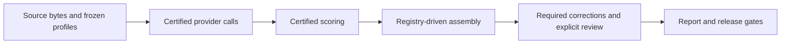

# Frozen WebMainBench comparison

WebMainBench compares Markdown returned from the same frozen HTML. It has a
separate population and scoring contract from the live-URL task benchmark in
[HEADLESS.md](HEADLESS.md).



## Select the population

| Population | Authority |
| --- | --- |
| Preselected sample | `evaluation/current-report.json` and its hash-bound sample manifest |
| Complete parent dataset | `evaluation/webmainbench-full/current-report.json` |
| Independently certified variants in the complete comparison | `evaluation/webmainbench-full/moli-variants.json` and each listed profile |

Profiles declare the task count, provider IDs, versions, source hash, scorer
commit, retry policy and execution contract. The registry declares public
variant identities; each variant profile declares its measured source provider.
Adding a variant changes this data, rather than adding a numbered assembler.
Profiles that certified historical calls retain their original bytes.

Acquire the source JSONL separately using the source and hash recorded in
`evaluation/public-webmainbench-200.json`. Follow its upstream license and the
repository's [third-party content boundary](../../THIRD_PARTY.md); a dataset
license does not grant rights to every captured third-party page.

Every method receives the source `html` field encoded as UTF-8. The selected
profile defines the allowed network access, conversion route and deadline.
Original URLs remain evidence metadata. This experiment measures frozen-page
conversion, not current website availability or live browsing success.

## Reproduce the sample's latency correction

The retained 200-page sample's balanced Moli latency correction uses
`scripts/run_certified_benchmark.py webmainbench-latency` and
`scripts/apply_webmainbench_latency_correction.py`. Both delegate to
`harness/web_fetch/webmainbench_latency_correction.py`. This frozen experiment
keeps its declared versions, two rounds, final-round selection, macOS host
observations and full 800-call scope. It does not change the scored outputs.
New certificates include `certifier-source.py` and its SHA-256; preserve this
file alongside `certification.json`, `selection.json`, `calls.jsonl` and outputs.
Source copies are verified as data and never executed. Historical source
bindings name exact Git revisions rather than the current command file.

## Certify, score and assemble the complete comparison

Install the `headless-eval` and `webmainbench-eval` extras, prepare the declared
browser binaries and obtain the pinned scorer checkout. Evaluation credentials
come only from the repository's local `.env`. Provider runs may incur charges.

The supported complete-cohort commands are:

- `scripts/run_certified_webmainbench_full.py`: freeze and recheck source,
  scorer, binary and complete physical-call evidence around provider calls.
- `scripts/score_certified_webmainbench_full.py`: score every declared method
  and bind the score files to the cohort certificate.
- `scripts/assemble_webmainbench_full.py`: verify and package the complete
  baseline and all registry-declared variant cohorts.
- `scripts/build_report.py --webmainbench-full`: build from persisted evidence
  after the current profile's correction, content and review bindings pass.

Run and score each independently declared cohort with its own profile. For
assembly, provide one baseline root and one `--cohort ID=PATH` argument for
every public variant ID in the selected registry:

```bash
uv run --frozen --extra headless-eval --extra webmainbench-eval python \
  scripts/assemble_webmainbench_full.py \
  --source-root /absolute/path/certified-baseline \
  --dataset /absolute/path/WebMainBench_545.jsonl \
  --profile evaluation/webmainbench-full/current-report.json \
  --variants evaluation/webmainbench-full/moli-variants.json \
  --cohort 'REGISTERED_ID=/absolute/path/certified-variant' \
  --scorer /absolute/path/pinned-scorer \
  --output /absolute/path/new-complete-evidence
```

Replace `REGISTERED_ID` and repeat `--cohort` for every registry entry. Omitting
`--variants` and all `--cohort` arguments packages the certified baseline alone.
A baseline-only package is not the complete registered comparison and cannot
pass its report release gate.

Assembly verifies the same source population and scorer across cohorts,
retains every physical retry, and gives each logical result a stable public
method identity. It copies only declared, hash-verified evidence, never worker
directories or private review files. It rejects incomplete matrices, duplicate
attempt identities, symlinks, changed inputs and existing output directories.
A failed assembly leaves no partial package.

New combined evidence uses `method-binding.json`. The reader also accepts the
frozen historical `seven-method-binding.json` format; both files in one package
are rejected as ambiguous. Historical reports and certificates are not
rewritten or re-certified by this migration.

To replace a method, certify its new cohort under a new frozen profile, update
the registry for the intended comparison and assemble a new package using the
unchanged original cohorts for other methods. Keep the previous package. Do
not copy or edit an existing scored matrix to manufacture a replacement.

## Interpret the scores

The deterministic official scorer evaluates `text_edit`, `code_edit`,
`formula_edit`, `table_edit` and `table_TEDS`. Official `overall` is the mean of
these separately aggregated components. Component populations can differ;
per-page `overall` does not replace the leaderboard aggregate. Delivery,
latency and retained retry execution cost remain separate measures.

Reference or scoring corrections use the shared revision contracts and retain
superseded evidence. Independent result review starts only on explicit request.
The published report's profile and target bind the exact accepted comparison;
assembling evidence alone does not authorize a release or change its scores.
