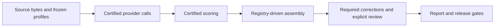

# Frozen WebMainBench comparison

WebMainBench compares Markdown returned from the same frozen HTML. It has a
separate population and scoring contract from the live-URL task benchmark in
[HEADLESS.md](HEADLESS.md).



[Choose a dataset](#select-the-population) · [Full comparison](#certify-score-and-assemble-the-complete-comparison) · [Read the scores](#interpret-the-scores)

The sample correction sections below are for reproducing or repairing that historical sample. Start with the full-comparison section for the complete dataset.

## Select the population

| Population | Authority |
| --- | --- |
| Preselected sample | External sample profile and its hash-bound manifest |
| Complete parent dataset | External full-cohort authority bundle |
| Independently certified variants in the complete comparison | `evaluation/webmainbench-full/moli-variants.json` and each listed profile |

Profiles declare the task count, provider IDs, versions, source hash, scorer
commit, retry policy and execution contract. The registry declares public
variant identities; each variant profile declares its measured source provider.
Adding a variant changes this data, rather than adding a numbered assembler.
Profiles that certified historical calls retain their original bytes.

For a new run, use the [corrected HF edition](https://huggingface.co/datasets/Lexmount/LexBench-WebMainBench) selected in the [data lock](../benchmarks/data-lock.json); the Browser Eval runner resolves that source by default. Historical sample reproduction retains the original source and hash in `evaluation/public-webmainbench-200.json`. Follow the selected edition's source terms and the repository's [third-party content boundary](../../../THIRD_PARTY.md); a dataset license does not grant rights to every captured third-party page.

Every method receives the source `html` field encoded as UTF-8. The selected
profile defines the allowed network access, conversion route and deadline.
Original URLs remain evidence metadata. This experiment measures frozen-page
conversion, not current website availability or live browsing success.

## Reproduce the sample's latency correction

The retained 200-page sample's balanced Moli latency correction uses
`scripts/run_certified_benchmark.py webmainbench-latency` and
`scripts/apply_webmainbench_latency_correction.py`. Both delegate to
`src/harness/web_fetch/webmainbench_latency_correction.py`. This frozen experiment
keeps its declared versions, two rounds, final-round selection, macOS host
observations and full 800-call scope. It does not change the scored outputs.
New certificates include `certifier-source.py` and its SHA-256; preserve this
file alongside `certification.json`, `selection.json`, `calls.jsonl` and outputs.
Source copies are verified as data and never executed. Historical source
bindings name exact Git revisions rather than the current command file.

## Apply a sample fixture correction

For a proven fixture error in the sample, apply the one-case replacement
evidence to a new directory:

```bash
uv run --frozen python scripts/apply_webmainbench_case_correction.py \
  --source-root /absolute/path/original-provider-shards \
  --correction 'PROVIDER_ID=/absolute/path/one-case-replacement' \
  --dataset /absolute/path/WebMainBench_545.jsonl \
  --sample-manifest evaluation/public-webmainbench-200.json \
  --profile /absolute/path/sample-profile.json \
  --case-id CASE_ID --output /absolute/path/new-provider-shards
```

Use the frozen parent profile and repeat `--correction` for every corrected
provider. The bindings define the correction scope; optional `--providers`
must name exactly the same providers. The profile defines the complete method
inventory, source, sample, scorer and execution policy. The command verifies
the final-call retry chain, implementation identity and every retained response
hash. Other methods keep their original evidence bytes. Only referenced files
are copied; invalid or changing inputs leave no partial output. This step
assembles evidence and does not certify provider calls or publish a report.
The Make target accepts a single `CORRECTION=PROVIDER_ID=PATH` binding and
`WEBMAINBENCH_PROFILE` for a different frozen parent profile; use the command
directly for multiple bindings.

## Certify, score and assemble the complete comparison

Install the `headless-eval` and `webmainbench-eval` extras, prepare the declared
browser binaries and obtain the pinned scorer checkout. Evaluation credentials
come only from the repository's local `.env`. Provider runs may incur charges.

The supported complete-cohort commands are:

- `scripts/run_certified_webmainbench_full.py`: freeze and recheck source,
  scorer, binary and complete physical-call evidence around provider calls.
- `scripts/score_certified_webmainbench_full.py`: score every declared method
  and bind the score files to the cohort certificate.
- `scripts/assemble_webmainbench_full.py`: verify and package the complete
  baseline and all registry-declared variant cohorts.
- `scripts/build_report.py --webmainbench-full`: build from persisted evidence
  after the current profile's correction, content and review bindings pass.

Run and score each independently declared cohort with its own profile. For
an installed package, the corresponding commands are:

```bash
python -m harness.web_fetch.webmainbench_certification \
  --source /absolute/path/WebMainBench_545.jsonl --scorer /absolute/path/pinned-scorer \
  --profile /absolute/path/frozen-profile.json --config /absolute/path/providers.json \
  --env-file /absolute/path/checkout/.env --output-root /absolute/path/new-cohort
python -m harness.web_fetch.webmainbench_certification score \
  --source /absolute/path/WebMainBench_545.jsonl --scorer /absolute/path/pinned-scorer \
  --profile /absolute/path/frozen-profile.json --cohort /absolute/path/new-cohort
```

All paths are interpreted from the caller's working directory. Supply the frozen
profile explicitly with `--profile`. The default provider configuration is
`configs/providers.headless.json` in that directory; outside a checkout, supply
`--config` as well. The frozen profile selects a nonempty, unique
list of registered methods, their versions and the serial one-run policy for
all 545 tasks. Dataset names do not select a method list. A profile-bound binary
uses the executable from the provider configuration. Dirty scorer checkouts
and changed inputs are rejected. Scoring rechecks every measured shard against
its original cohort certificate before issuing a scoring certificate.

For assembly, provide one baseline root and one `--cohort ID=PATH` argument for
every public variant ID in the selected registry:

```bash
uv run --frozen --extra headless-eval --extra webmainbench-eval python \
  scripts/assemble_webmainbench_full.py \
  --source-root /absolute/path/certified-baseline \
  --dataset /absolute/path/WebMainBench_545.jsonl \
  --profile /absolute/path/full-profile.json \
  --variants /absolute/path/variant-registry.json \
  --cohort 'REGISTERED_ID=/absolute/path/certified-variant' \
  --scorer /absolute/path/pinned-scorer \
  --output /absolute/path/new-complete-evidence
```

Replace `REGISTERED_ID` and repeat `--cohort` for every registry entry. Omitting
`--variants` and all `--cohort` arguments packages the certified baseline alone.
A baseline-only package is not the complete registered comparison and cannot
pass its report release gate.

Assembly verifies the same source population and scorer across cohorts,
retains every physical retry, and gives each logical result a stable public
method identity. It copies only declared, hash-verified evidence, never worker
directories or private review files. It rejects incomplete matrices, duplicate
attempt identities, symlinks, changed inputs and existing output directories.
A failed assembly leaves no partial package.

New combined evidence uses `method-binding.json`. The reader also accepts the
frozen historical `seven-method-binding.json` format; both files in one package
are rejected as ambiguous. Historical reports and certificates are not
rewritten or re-certified by this migration.

To replace a method, certify its new cohort under a new frozen profile, update
the registry for the intended comparison and assemble a new package using the
unchanged original cohorts for other methods. Keep the previous package. Do
not copy or edit an existing scored matrix to manufacture a replacement.

## Interpret the scores

The deterministic official scorer evaluates `text_edit`, `code_edit`,
`formula_edit`, `table_edit` and `table_TEDS`. Official `overall` is the mean of
these separately aggregated components. Component populations can differ;
per-page `overall` does not replace the leaderboard aggregate. Delivery,
latency and retained retry execution cost remain separate measures.

Reference or scoring corrections use the shared revision contracts and retain
superseded evidence. Independent result review starts only on explicit request.
The published report's profile and target bind the exact accepted comparison;
assembling evidence alone does not authorize a release or change its scores.

`scripts/correct_webmainbench_scoring.py` applies a schema-v3 decision-authority
manifest to the complete 545-page population. It requires `--source`,
`--corrected-dataset`, `--manifest`, `--scorer-repo`, `--scorer-commit` and a new
`--output` directory. `scripts/rescore_webmainbench_case_correction.py` uses the
same arguments except `--manifest` to rescore an already certified case correction;
its HTML, reference and physical calls must retain their certified identities.
Both commands run offline through `src/harness/web_fetch/webmainbench_correction.py`,
validate the shared scoring controls and expose the output only after the complete
revision succeeds. The scorer checkout must match the declared commit and have no
tracked changes. Historical schema-v1 reference receipts remain readable; new
reference corrections use the schema-v3 command.

The retained sample's TEDS-only revision uses `scripts/correct_webmainbench_teds.py`.
Its scorer commit defaults to the frozen official baseline; `--scorer-commit` can
declare another checkout explicitly. The checkout must match that commit and the
source evidence's metric-source hashes. Revisions retain the first official score
snapshots and aggregate, stage a complete new directory and reject source changes
during scoring. `--prior-corrected` reuses an already validated correction while
checking that its evidence also remains unchanged.
`scripts/review_webmainbench_teds_correction.py --source <original-evidence>
--corrected <revised-evidence>` checks its complete declared matrix, unchanged
provider evidence and aggregate arithmetic. Both commands delegate to
`webmainbench_diagnostics.py`. This is a deterministic integrity check; independent
result review is a separate, explicitly requested activity. The audit command
preserves an existing receipt and rejects evidence that changes before installation.
